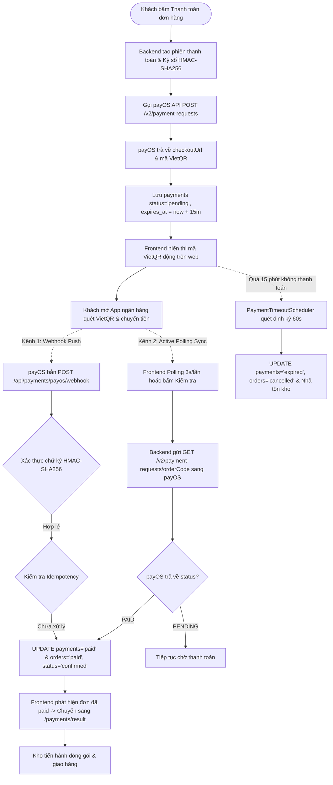
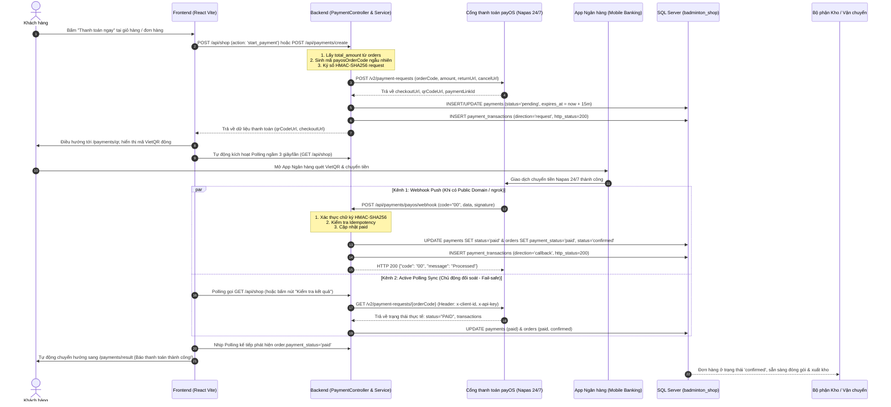

# LUỒNG HOẠT ĐỘNG MODULE THANH TOÁN (PAYMENT FLOW)
> **Dự án:** Badminton Shop Management System (SBA301_BadmintonShop_SE1986-JV)  
> **Cổng thanh toán:** payOS (VietQR Napas 24/7)  
> **Công nghệ:** Java 21, Spring Boot 3, Spring Data JPA, Spring Security, SQL Server, React (Vite)  
> **Chuẩn kiến trúc:** RESTful Zero `/v1/` (`/api/payments`)

---

## 1. NGUYÊN TẮC CỐT LÕI & QUYẾT ĐỊNH NGHIỆP VỤ

1. **Loại bỏ hoàn toàn COD (100% Trả trước trực tuyến):**  
   * Tất cả các đơn hàng online bắt buộc thanh toán trực tuyến qua cổng **payOS (VietQR Napas 24/7)** trước khi xác nhận đơn và xuất kho giao hàng.
   * Cửa hàng áp dụng chính sách **0đ phí vận chuyển (Freeship toàn quốc)** cho mọi đơn hàng.
2. **Cơ chế đối soát kép (Dual Verification):**  
   * **Kênh 1 - Webhook Push (Thụ động):** Ngay khi khách chuyển tiền, payOS gửi HTTP POST request về Backend. Backend kiểm tra chữ ký số **HMAC-SHA256 Canonical (A-Z)** và cập nhật đơn hàng thành `paid` tức thì (< 1s).
   * **Kênh 2 - Active Polling Sync (Chủ động - Fail-safe):** Khi khách đang mở màn hình quét mã VietQR, Frontend tự động kích hoạt polling định kỳ 3 giây/lần gọi về Backend để Backend tra cứu API payOS `GET /v2/payment-requests/{orderCode}` (hoặc khi khách bấm nút *"Kiểm tra kết quả giao dịch"*).  
   * **Giá trị thực tiễn:** Giúp hệ thống hoạt động tự động hoàn hảo ngay trên Localhost mà không cần cài đặt ngrok, đồng thời là cơ chế dự phòng cứu cánh trên Production phòng khi Webhook bị nghẽn mạng.
3. **Cơ chế Idempotency (Chống xử lý lặp giao dịch):**  
   * Hàm `markPaymentAsPaid()` kiểm tra nếu giao dịch đã ở trạng thái `paid` thì ghi log và bỏ qua cập nhật trùng lặp, đảm bảo không có xung đột giữa 2 kênh Webhook và Polling.
4. **Thời hạn thanh toán 15 phút (Timeout Scheduler):**  
   * Mỗi link thanh toán VietQR có thời gian hiệu lực là 15 phút.
   * `PaymentTimeoutScheduler` chạy định kỳ mỗi 60 giây quét các đơn quá hạn: chuyển `payments.status = 'expired'`, tự động hủy đơn (`orders.status = 'cancelled'`) và nhả tồn kho sản phẩm về lại cửa hàng.
5. **Bảo mật thanh toán & Cô lập dữ liệu (Security & Data Isolation):**  
   * Khách hàng chỉ có thể tra cứu và thao tác trên phiên thanh toán của chính mình qua bộ lọc [`PaymentAccess.java`](file:///backend/badmintonshop/src/main/java/fu/se/badmintonshop/modules/payment/controller/PaymentAccess.java) (`if (!userId.equals(order.getUserId())) throw Forbidden`).
   * Không thể can thiệp hoặc làm giả số tiền từ URL hay body request: Số tiền thanh toán được lấy 100% từ `orders.total_amount` trong Database và được bảo vệ bằng chữ ký HMAC-SHA256 khi gửi sang payOS.

---

## 2. SƠ ĐỒ LUỒNG HOẠT ĐỘNG (FLOWCHART & SEQUENCE DIAGRAM)

### 2.1. Sơ đồ tổng quan quy trình thanh toán (Flowchart)

---

### 2.2. Sơ đồ tuần tự chi tiết (Sequence Diagram)

---

## 3. BẢNG TRẠNG THÁI THANH TOÁN & ĐỒNG BỘ ĐƠN HÀNG

| `payments.status` | `orders.payment_status` | `orders.status` | Ý nghĩa nghiệp vụ |
| :--- | :--- | :--- | :--- |
| `pending` | `unpaid` | `pending` | Đơn hàng vừa tạo, đang chờ khách quét VietQR trong hạn 15 phút |
| `paid` | `paid` | `confirmed` | Đã nhận thanh toán thành công. Đơn hàng chuyển kho đóng gói |
| `expired` | `unpaid` | `cancelled` | Hết 15 phút khách không chuyển tiền. Tự hủy đơn và nhả lại tồn kho |
| `cancelled` | `unpaid` | `cancelled` | Khách chủ động hủy yêu cầu thanh toán |
| `failed` | `unpaid` | `pending` | Giao dịch cổng bị lỗi, khách có thể tạo lại phiên thanh toán |
| `refunded` | `refunded` | `returned` | Đã hoàn tất chuyển khoản tiền trả lại cho khách sau khi duyệt đổi trả |

---

## 4. DANH MỤC API SPECIFICATIONS MODULE PAYMENT (ZERO `/v1/`)

| Method | Endpoint | Quyền truy cập | Mục đích nghiệp vụ |
| :--- | :--- | :--- | :--- |
| `POST` | `/api/shop` | Authenticated | Khởi tạo phiên thanh toán qua action `{ "type": "start_payment", "order_id": 105 }` |
| `POST` | `/api/payments/create` | Authenticated | Tạo phiên thanh toán payOS VietQR độc lập |
| `GET` | `/api/payments/{id}` | Authenticated (Chính chủ) | Tra cứu thông tin thanh toán theo Payment ID |
| `GET` | `/api/payments/{id}/sync` | Authenticated (Chính chủ) | Kích hoạt Backend đối soát trực tiếp với API payOS theo Payment ID |
| `GET` | `/api/payments/order/{orderId}` | Authenticated (Chính chủ) | Xem lịch sử các lần thanh toán của một đơn hàng |
| `GET` | `/api/payments/order/{orderId}/sync` | Authenticated (Chính chủ) | Kích hoạt Backend đối soát trực tiếp với API payOS theo Order ID |
| `GET` | `/api/payments/by-code/{code}` | Authenticated (Chính chủ) | Tra cứu theo mã nội bộ `PAY-yyyyMMdd-XXXXX` |
| `GET` | `/api/payments/by-payos-code/{code}` | Authenticated (Chính chủ) | Tra cứu theo mã số nguyên payOS (`payosOrderCode`) |
| `POST` | `/api/payments/{id}/cancel` | Authenticated (Chính chủ) | Hủy phiên thanh toán đang chờ |
| `POST` | `/api/payments/payos/webhook` | Public | Cổng payOS bắn Webhook thông báo kết quả (Xác thực chữ ký HMAC-SHA256) |
| `POST` | `/api/payments/payos/confirm-webhook` | `ROLE_ADMIN` | Gửi yêu cầu xác thực Webhook URL tới cổng payOS khi deploy |
