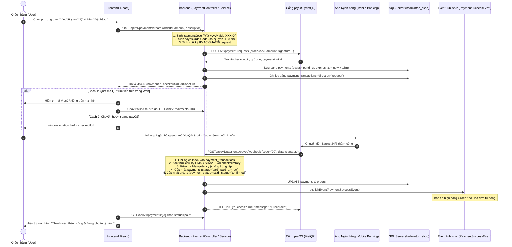
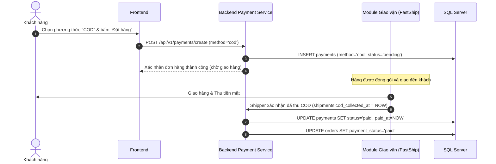
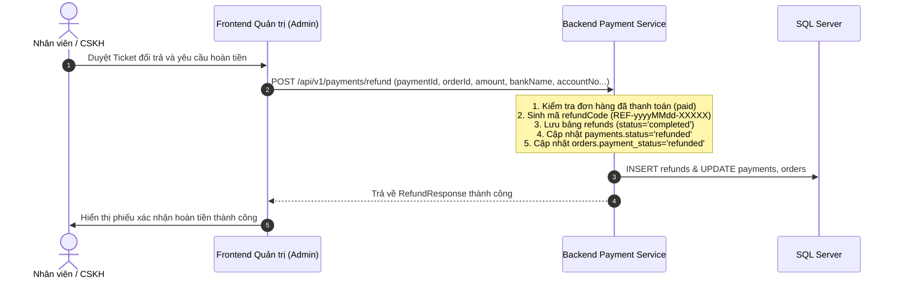

# LUỒNG HOẠT ĐỘNG MODULE THANH TOÁN (PAYMENT FLOW)
> **Dự án:** SBA301_BadmintonShop_SE1986-JV  
> **Cổng thanh toán:** payOS (VietQR Napas 24/7), COD (Thu tiền khi nhận hàng), Cash (Tiền mặt tại quầy)  
> **Kiến trúc:** Java 21, Spring Boot, Spring Data JPA, Spring Security, SQL Server, Event-Driven

---

## 1. TỔNG QUAN KIẾN TRÚC & CÁC PHƯƠNG THỨC THANH TOÁN

Hệ thống hỗ trợ 3 luồng thanh toán chính:
1. **payOS (VietQR):** Thanh toán tự động 24/7 qua cổng OpenBanking / Napas 24/7. Khách quét mã VietQR bằng ứng dụng ngân hàng bất kỳ, Webhook tự động cập nhật đơn hàng sang `paid` và `confirmed` trong vòng vài giây.
2. **COD (Cash on Delivery):** Thanh toán tiền mặt khi shipper giao hàng thành công. Trạng thái thanh toán được đồng bộ khi shipper xác nhận đã thu tiền (`cod_collected_at`).
3. **Refund (Hoàn tiền):** Áp dụng khi đổi trả hàng (`support_tickets`), hỗ trợ hoàn tiền qua chuyển khoản ngân hàng thủ công hoặc tự động qua cổng.

---

## 2. CHI TIẾT CÁC LUỒNG HOẠT ĐỘNG (FLOWS & SEQUENCE DIAGRAMS)

### 2.1. Luồng 1: Thanh toán trực tuyến qua payOS (VietQR Flow)



---

### 2.2. Luồng 2: Thanh toán khi nhận hàng (COD Flow)



---

### 2.3. Luồng 3: Xử lý Hoàn tiền (Refund Flow)



---

## 3. CƠ CHẾ BẢO MẬT VÀ XỬ LÝ LỖI TRONG LUỒNG THANH TOÁN

### 3.1. Xác thực chữ ký số Webhook (HMAC-SHA256)
* Khi payOS gửi dữ liệu qua webhook, server tính toán lại mã băm HMAC-SHA256 từ object `data` theo thứ tự chữ cái của các trường (canonical alphabet sorting).
* Nếu chữ ký tính được **khớp** với `signature` từ payOS $\rightarrow$ Chấp nhận giao dịch.
* Nếu chữ ký **sai lệch** (bị sửa đổi payload trên đường truyền hoặc bị kẻ gian bắn webhook giả) $\rightarrow$ Từ chối ngay lập tức, không cập nhật DB.

### 3.2. Cơ chế Idempotency (Chống xử lý trùng lặp giao dịch)
* Trong môi trường mạng, payOS có thể retry gửi Webhook nhiều lần nếu đường truyền chập chờn.
* Khi nhận webhook, `PaymentServiceImpl` kiểm tra trạng thái hiện tại của `Payment`:
  * Nếu `payment.getStatus().equals("paid")`, hệ thống ghi nhận log và **bỏ qua không cập nhật lại**, trả về HTTP 200 `{ "success": true }`.
  * Tránh rủi ro cộng tiền 2 lần, bắn duplicate event hoặc xuất trùng hóa đơn.

### 3.3. Thời hạn phiên thanh toán (Timeout & Expired)
* Mỗi link payOS có trường `expires_at = NOW + 15 phút`.
* Sau 15 phút nếu khách không quét mã chuyển khoản, cron job hoặc scheduler có thể quét các payment `pending` quá hạn $\rightarrow$ chuyển trạng thái sang `expired` và nhả số lượng tồn kho sản phẩm.

---

## 4. BẢNG TRẠNG THÁI THANH TOÁN & ĐỒNG BỘ ĐƠN HÀNG

| Trạng thái `payments.status` | Trạng thái `orders.payment_status` | Trạng thái `orders.status` | Ý nghĩa nghiệp vụ |
| :--- | :--- | :--- | :--- |
| `pending` | `unpaid` | `pending` | Đơn hàng vừa tạo, đang chờ khách quét QR hoặc chờ giao COD |
| `paid` | `paid` | `confirmed` | Khách đã chuyển khoản thành công / Đã thu COD. Đơn sẵn sàng đóng gói |
| `failed` | `unpaid` | `pending` | Giao dịch qua cổng bị lỗi, khách có thể bấm "Thanh toán lại" |
| `expired` | `unpaid` | `cancelled` | Hết 15 phút khách không trả tiền, đơn bị hủy và nhả kho |
| `cancelled` | `unpaid` | `cancelled` | Khách chủ động hủy yêu cầu thanh toán |
| `refunded` | `refunded` | `returned` / `completed` | Đã xử lý hoàn tiền lại cho khách hàng |

---

## 5. CÁC API ENDPOINTS PHỤC VỤ LUỒNG THANH TOÁN

| Method | Endpoint | Mục đích | Quyền truy cập |
| :--- | :--- | :--- | :--- |
| `POST` | `/api/v1/payments/create` | Tạo phiên thanh toán (payOS, COD, cash) | Public |
| `GET` | `/api/v1/payments/{id}` | Tra cứu trạng thái thanh toán theo ID | Public |
| `GET` | `/api/v1/payments/by-code/{code}` | Tra cứu theo mã nội bộ `PAY-...` | Public |
| `GET` | `/api/v1/payments/by-payos-code/{code}` | Tra cứu theo mã số nguyên payOS | Public |
| `GET` | `/api/v1/payments/order/{orderId}` | Lịch sử các lần thanh toán của đơn | Public |
| `POST` | `/api/v1/payments/{id}/cancel` | Hủy link thanh toán | Public |
| `POST` | `/api/v1/payments/refund` | Tạo phiếu hoàn tiền | Admin / Staff |
| `POST` | `/api/v1/payments/payos/webhook` | Cổng payOS bắn Webhook thông báo | Public (Bảo vệ bằng HMAC) |
| `POST` | `/api/v1/payments/payos/confirm-webhook`| Xác thực URL khi cài đặt payOS | Public |

---

## 6. HƯỚNG DẪN TEST MOCK TOÀN BỘ LUỒNG (POSTMAN & CURL)

### Bước 1: Tạo phiên thanh toán (Tạo mã QR / Link)
```bash
curl -X POST http://localhost:8080/api/v1/payments/create \
  -H "Content-Type: application/json" \
  -d '{
    "orderId": 1,
    "amount": 1500000,
    "method": "payos",
    "description": "Vot Yonex Astrox 88D",
    "buyerName": "Nguyen Van A",
    "buyerEmail": "a.nguyen@example.com",
    "buyerPhone": "0912345678"
  }'
```
*Nhận về `payosOrderCode` (ví dụ: `5567891234`) và `checkoutUrl`.*

### Bước 2: Giả lập Webhook payOS báo chuyển khoản thành công
```bash
curl -X POST http://localhost:8080/api/v1/payments/payos/webhook \
  -H "Content-Type: application/json" \
  -d '{
    "code": "00",
    "desc": "success",
    "data": {
      "orderCode": 5567891234,
      "amount": 1500000,
      "description": "Vot Yonex Astrox 88D",
      "accountNumber": "1903678910",
      "reference": "FT2610318899",
      "currency": "VND",
      "code": "00"
    },
    "signature": "d682498522646c05dbb320d75a34e0622e03fcba0bf3e0f9b378033ee9bc27a9"
  }'
```

### Bước 3: Kiểm tra trạng thái thanh toán đã sang `paid`
```bash
curl http://localhost:8080/api/v1/payments/1
```
*Trường `status` sẽ trả về `"paid"` và `gatewayTxnRef` là `"FT2610318899"`.*

