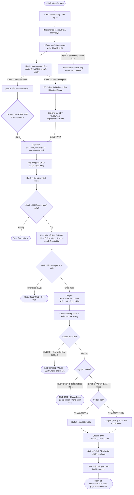
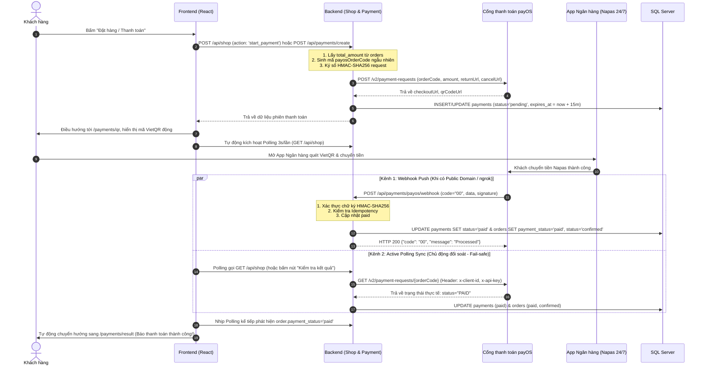
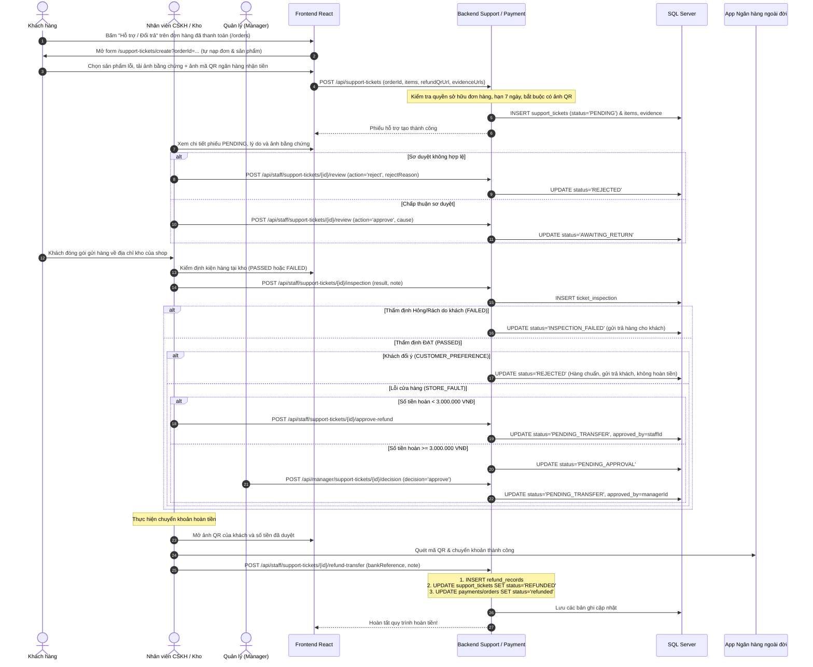

# LUỒNG HOẠT ĐỘNG TOÀN DIỆN: MODULE THANH TOÁN (PAYMENT) & HỖ TRỢ ĐỔI TRẢ (SUPPORT TICKET)
> **Dự án:** Badminton Shop Management System (SBA301_BadmintonShop_SE1986-JV)  
> **Công nghệ:** Java 21, Spring Boot 3, Spring Data JPA, Spring Security, SQL Server, React (Vite), payOS (VietQR Napas 24/7)  
> **Phạm vi tài liệu:** Hợp nhất luồng nghiệp vụ khép kín từ khâu Đặt hàng & Thanh toán trực tuyến (payOS) đến Hỗ trợ sau bán hàng, Thẩm định hàng trả về & Hoàn tiền thủ công (UC15: Returns & Refunds).

---

## 1. NGUYÊN TẮC CỐT LÕI & QUYẾT ĐỊNH NGHIỆP VỤ

1. **Thanh toán trực tuyến 100% (Loại bỏ COD):**  
   * Tất cả đơn hàng trực tuyến bắt buộc thanh toán trả trước qua cổng **payOS (VietQR Napas 24/7)** trước khi xác nhận đơn và xuất kho.
   * Phí vận chuyển áp dụng chính sách **0đ (Freeship toàn quốc)** cho mọi đơn hàng.
2. **Cơ chế đối soát kép (Dual Verification):**  
   * **Kênh 1 - Webhook Push (Thụ động):** Cổng payOS tự động gửi tín hiệu POST kèm chữ ký số HMAC-SHA256 về Backend khi tiền vào tài khoản. Đơn hàng chuyển sang `paid` ngay tức thì (< 1s).
   * **Kênh 2 - Active Polling Sync (Chủ động):** Frontend mở màn hình QR tự động polling 3s/lần gọi về Backend để Backend tra cứu API payOS `GET /v2/payment-requests/{orderCode}`. Đảm bảo giao dịch luôn cập nhật thành công ngay cả khi chạy trên Localhost không có ngrok hoặc khi Webhook bị nghẽn mạng trên Production.
   * **Idempotency:** Kiểm tra chống xử lý trùng lặp giao dịch trên toàn hệ thống.
3. **Thời hạn thanh toán 15 phút (Timeout Scheduler):**  
   * Mỗi mã VietQR có hiệu lực trong 15 phút. Hệ thống quét định kỳ mỗi 60 giây; nếu quá hạn mà chưa thanh toán thì tự động chuyển `payments.status = 'expired'`, hủy đơn hàng (`orders.status = 'cancelled'`) và nhả tồn kho về cho sản phẩm.
4. **Phạm vi đổi trả sau bán hàng (Chỉ Trả hàng & Hoàn tiền - REFUND):**  
   * Khách hàng tạo phiếu trực tiếp từ đơn hàng đã thanh toán (`payment_status = 'paid'`) trong vòng **7 ngày** kể từ khi nhận hàng.
   * **Bắt buộc upload ảnh mã QR tài khoản ngân hàng nhận tiền** + ảnh/video bằng chứng (không nhập số tài khoản text để loại bỏ sai sót).
   * **Chính sách chỉ hoàn tiền khi lỗi từ cửa hàng (`STORE_FAULT`):** Giao sai mẫu, sai kích thước, lỗi sản xuất, hư hại khi vận chuyển. Cửa hàng hoàn 100% tiền hàng và phí ship ban đầu.
   * Nếu hàng hoàn về đạt chuẩn nhưng do **khách đổi ý cá nhân (`CUSTOMER_PREFERENCE`)** $\rightarrow$ Hệ thống **từ chối phiếu (`REJECTED`)**, gửi trả lại sản phẩm cho khách và **không hoàn tiền**.
   * **Không nhập lại kho (`No Restock`):** Hàng lỗi thu hồi được cách ly để chuyển bảo hành hãng hoặc tiêu hủy, không cộng lại tồn kho bán đại trà.
5. **Phân quyền duyệt hoàn tiền 2 cấp độ (Ngưỡng 3.000.000 VNĐ):**  
   * Khoản hoàn **< 3.000.000 VNĐ**: Nhân viên CSKH (`STAFF`) phê duyệt trực tiếp sang trạng thái chờ chuyển tiền (`PENDING_TRANSFER`).
   * Khoản hoàn **$\ge$ 3.000.000 VNĐ**: Chuyển Quản lý (`MANAGER`) thẩm định và ra quyết định phê duyệt (`PENDING_APPROVAL`).
6. **Thực hiện hoàn tiền thủ công (Manual QR Transfer - An toàn tài chính):**  
   * Nhân viên mở App ngân hàng quét trực tiếp ảnh QR do khách upload, chuyển đúng số tiền đã duyệt, sau đó **nhập Mã giao dịch ngân hàng (`bank_reference`)** vào hệ thống để kết thúc quy trình (`REFUNDED`). Không sử dụng Payout API tự động trừ tiền tài khoản.

---

## 2. SƠ ĐỒ LUỒNG HOẠT ĐỘNG TỔNG THỂ (END-TO-END FLOW)

---

## 3. CHI TIẾT SƠ ĐỒ TUẦN TỰ (SEQUENCE DIAGRAMS)

### 3.1. Luồng 1: Thanh toán trực tuyến payOS VietQR (Dual Verification)

---

### 3.2. Luồng 2: Hỗ trợ sau bán hàng & Hoàn tiền đổi trả (Support Ticket & Manual Refund)

---

## 4. MA TRẬN CHUYỂN ĐỔI TRẠNG THÁI (STATE MACHINE)

### 4.1. Bảng đồng bộ trạng thái Thanh toán & Đơn hàng

| `payments.status` | `orders.payment_status` | `orders.status` | Ý nghĩa nghiệp vụ |
| :--- | :--- | :--- | :--- |
| `pending` | `unpaid` | `pending` | Khách vừa đặt hàng, đang chờ quét VietQR trong 15 phút |
| `paid` | `paid` | `confirmed` | Đã nhận thanh toán thành công. Đơn hàng sẵn sàng đóng gói & giao |
| `expired` | `unpaid` | `cancelled` | Quá 15 phút không thanh toán. Tự động hủy đơn và nhả lại tồn kho |
| `cancelled` | `unpaid` | `cancelled` | Khách hàng chủ động hủy phiên thanh toán |
| `failed` | `unpaid` | `pending` | Giao dịch cổng lỗi, khách có thể tạo lại phiên thanh toán |
| `refunded` | `refunded` | `returned` | Đã chuyển khoản hoàn tiền thành công cho khách sau khi duyệt ticket |

---

### 4.2. Bảng vòng đời trạng thái Phiếu hỗ trợ (Support Ticket Lifecycle)

| Trạng thái | Tên hiển thị | Vai trò xử lý | Điều kiện chuyển tiếp |
| :--- | :--- | :--- | :--- |
| `PENDING` | Chờ tiếp nhận sơ duyệt | Khách hàng, Staff | Phiếu vừa tạo. Khách có thể bấm **Hủy (`CANCELLED`)**. Staff duyệt (`AWAITING_RETURN`) hoặc từ chối (`REJECTED`). |
| `AWAITING_RETURN` | Chờ khách gửi lại hàng | Khách hàng, Staff | Khách đóng gói gửi hàng về kho. Nhân viên nhận hàng và ghi biên bản kiểm định. |
| `INSPECTION_FAILED`| Kiểm tra hàng không đạt | - | Trạng thái kết thúc. Hàng bị rách/hỏng do lỗi người dùng. Gửi trả lại khách, chặn hoàn tiền. |
| `PENDING_APPROVAL` | Chờ Quản lý duyệt | Quản lý (`MANAGER`) | Hàng đạt chuẩn do lỗi shop nhưng số tiền hoàn $\ge 3.000.000$ VNĐ. Quản lý duyệt hoặc từ chối. |
| `PENDING_TRANSFER` | Chờ chuyển tiền | Nhân viên (`STAFF`) | Khoản hoàn đã được duyệt (Staff duyệt nếu $< 3$M, Quản lý duyệt nếu $\ge 3$M). Chờ Staff quét QR chuyển khoản. |
| `REFUNDED` | Đã hoàn tiền | - | Trạng thái kết thúc. Staff nhập mã giao dịch ngân hàng thành công. Ghi nhận `refund_records`. |
| `REJECTED` | Bị từ chối | - | Trạng thái kết thúc. Bị từ chối ở bước sơ duyệt, hoặc do khách đổi ý (`CUSTOMER_PREFERENCE`), hoặc do Quản lý từ chối. |
| `CANCELLED` | Khách đã hủy | - | Trạng thái kết thúc. Khách chủ động hủy khi phiếu còn ở `PENDING`. |

---

## 5. DANH MỤC API ĐẶC TẢ CHÍNH THỨC (API SPECIFICATIONS)

### 5.1. Nhóm API Thanh toán (`/api/payments` & `/api/shop`)

| Method | Endpoint | Quyền truy cập | Chức năng nghiệp vụ |
| :--- | :--- | :--- | :--- |
| `POST` | `/api/shop` | Authenticated | Khởi tạo thanh toán VietQR với action `{ "type": "start_payment", "order_id": 105 }` |
| `POST` | `/api/payments/create` | Authenticated | Tạo phiên thanh toán payOS VietQR độc lập |
| `GET` | `/api/payments/{id}` | Authenticated (Chính chủ) | Tra cứu trạng thái thanh toán theo Payment ID |
| `GET` | `/api/payments/order/{orderId}` | Authenticated (Chính chủ) | Tra cứu lịch sử thanh toán theo Order ID |
| `GET` | `/api/payments/{id}/sync` | Authenticated (Chính chủ) | Kích hoạt Backend đối soát trực tiếp với API payOS theo Payment ID |
| `GET` | `/api/payments/order/{orderId}/sync` | Authenticated (Chính chủ) | Kích hoạt Backend đối soát trực tiếp với API payOS theo Order ID |
| `POST` | `/api/payments/{id}/cancel` | Authenticated (Chính chủ) | Hủy phiên thanh toán đang chờ |
| `POST` | `/api/payments/payos/webhook` | Public | payOS bắn tín hiệu Webhook tự động (Xác thực chữ ký HMAC-SHA256) |
| `POST` | `/api/payments/payos/confirm-webhook` | `ROLE_ADMIN` | Gửi yêu cầu xác thực Webhook URL tới cổng payOS |

### 5.2. Nhóm API Hỗ trợ Đổi trả (`/api/support-tickets`)

| Method | Endpoint | Quyền truy cập | Chức năng nghiệp vụ |
| :--- | :--- | :--- | :--- |
| `POST` | `/api/support-tickets` | Authenticated (Chính chủ) | Khách tạo yêu cầu Trả hàng & Hoàn tiền kèm ảnh QR và bằng chứng |
| `GET` | `/api/support-tickets` | Authenticated (Chính chủ) | Khách xem danh sách phiếu hỗ trợ của tài khoản mình |
| `GET` | `/api/support-tickets/{id}` | Authenticated (Chính chủ/NV) | Xem chi tiết tiến trình phiếu hỗ trợ |
| `POST` | `/api/support-tickets/{id}/cancel` | Authenticated (Chính chủ) | Khách hủy yêu cầu hỗ trợ (chỉ khi còn ở trạng thái `PENDING`) |
| `GET` | `/api/staff/support-tickets` | `STAFF`, `MANAGER`, `ADMIN` | Hàng đợi danh sách phiếu hỗ trợ cần xử lý |
| `POST` | `/api/staff/support-tickets/{id}/review` | `STAFF`, `MANAGER`, `ADMIN` | Sơ duyệt tiếp nhận: chọn `cause` hoặc từ chối phiếu |
| `POST` | `/api/staff/support-tickets/{id}/inspection` | `STAFF`, `MANAGER`, `ADMIN` | Ghi nhận biên bản kiểm định hàng tại kho (`PASSED` / `FAILED`) |
| `POST` | `/api/staff/support-tickets/{id}/approve-refund` | `STAFF`, `MANAGER`, `ADMIN` | Nhân viên duyệt hoàn tiền cho khoản hoàn < 3.000.000 VNĐ |
| `POST` | `/api/manager/support-tickets/{id}/decision` | `MANAGER`, `ADMIN` | Quản lý phê duyệt hoặc từ chối khoản hoàn $\ge 3.000.000$ VNĐ |
| `POST` | `/api/staff/support-tickets/{id}/refund-transfer` | `STAFF`, `MANAGER`, `ADMIN` | Nhân viên nhập `bankReference` xác nhận đã chuyển khoản manual thành công |
