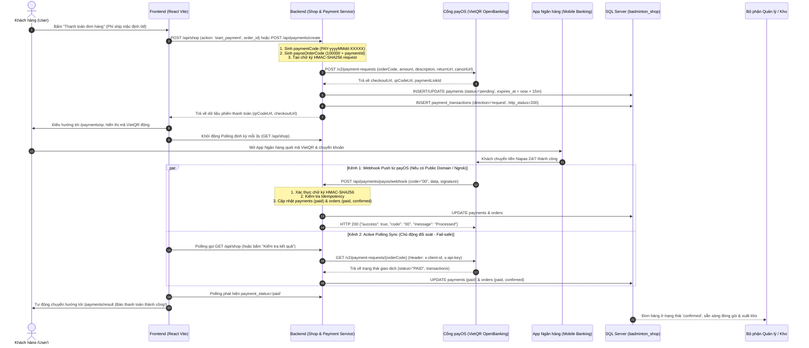
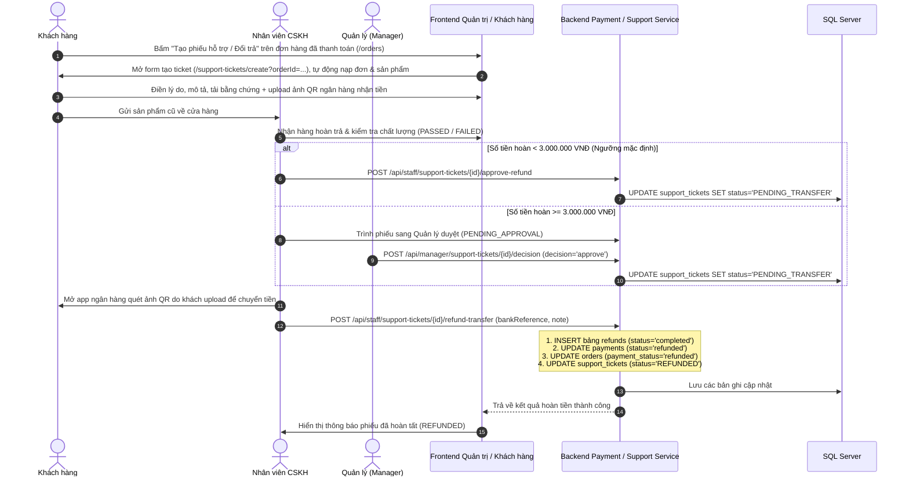

# LUỒNG HOẠT ĐỘNG MODULE THANH TOÁN (PAYMENT FLOW)
> **Dự án:** SBA301_BadmintonShop_SE1986-JV  
> **Cổng thanh toán:** payOS (VietQR Napas 24/7)  
> **Quyết định phạm vi (Scope Decision):**  
> 1. **LOẠI BỎ HOÀN TOÀN COD**. 100% đơn hàng online bắt buộc thanh toán trực tuyến qua payOS VietQR trước khi xuất kho giao hàng.  
> 2. **PHÍ VẬN CHUYỂN MẶC ĐỊNH 0Đ (FREESHIP TOÀN QUỐC)**.  
> 3. **CƠ CHẾ ĐỐI SOÁT KÉP (DUAL VERIFICATION)**: Webhook Push kết hợp Active Polling Sync Pull qua API payOS `GET /v2/payment-requests/{orderCode}`.  
> 4. **TÍCH HỢP SUPPORT TICKET TỪ ĐƠN HÀNG**: Nút tạo ticket trực tiếp trên các đơn hàng đã thanh toán.  
> **Kiến trúc:** Java 21, Spring Boot 3, Spring Data JPA, Spring Security, SQL Server, RESTful Architecture (Chuẩn Zero `/v1/`: `/api/payments`)

---

## 1. TỔNG QUAN KIẾN TRÚC & CÁC PHƯƠNG THỨC THANH TOÁN

Hệ thống hỗ trợ 2 luồng nghiệp vụ chính:
1. **payOS (VietQR Napas 24/7) với cơ chế Đối soát kép (Dual Verification):**
   - Khách quét mã VietQR bằng ứng dụng ngân hàng bất kỳ.
   - **Kênh Webhook Push:** payOS tự động bắn Webhook về Backend, kiểm tra chữ ký HMAC-SHA256 và cập nhật đơn hàng tức thì.
   - **Kênh Active Polling Sync Pull:** Backend chủ động gọi API `GET /v2/payment-requests/{orderCode}` của payOS để đối soát trong lúc khách mở màn hình QR (hoặc khi bấm nút *"Kiểm tra kết quả giao dịch"*). Đảm bảo giao dịch luôn được ghi nhận kể cả khi Webhook bị lag, mạng chập chờn hoặc khi chạy dev trên Localhost mà không cần ngrok.
2. **Refund (Hoàn tiền đổi trả thủ công qua quét QR):**
   - Áp dụng khi đổi trả hàng (`support_tickets` - UC15). Khách hàng có thể ấn nút tạo ticket trực tiếp từ danh sách đơn hàng đã thanh toán (`OrdersPage.jsx`).
   - Phân quyền duyệt hoàn tiền 2 cấp độ: `< 3.000.000 VNĐ` (`STAFF`) và $\ge$ 3.000.000 VNĐ (`MANAGER`).

---

## 2. CHI TIẾT CÁC LUỒNG HOẠT ĐỘNG (FLOWS & SEQUENCE DIAGRAMS)

### 2.1. Luồng 1: Thanh toán trực tuyến qua payOS VietQR (Dual Verification Flow)

---

### 2.2. Luồng 2: Xử lý Hoàn tiền đổi trả (Refund Flow - UC15 & UC13)

---

## 3. CƠ CHẾ BẢO MẬT VÀ TÍNH NĂNG ĐẶC BIỆT

### 3.1. Xác thực chữ ký số Webhook (HMAC-SHA256)
* Khi payOS gửi dữ liệu qua Webhook, server sắp xếp các trường trong object `data` theo thứ tự chữ cái (canonical sorting) và tạo chuỗi query `key1=value1&key2=value2...`.
* Server tính mã băm HMAC-SHA256 của chuỗi trên với `PAYOS_CHECKSUM_KEY`.
* **Xác thực thành công:** Nếu mã băm khớp chính xác với `webhookRequest.getSignature()` $\rightarrow$ Tiến hành xử lý cập nhật đơn hàng.
* **Xác thực thất bại:** Nếu chữ ký không khớp $\rightarrow$ Bị từ chối ngay lập tức (`SecurityException`), trả về HTTP 400 và không cập nhật CSDL.

### 3.2. Cơ chế Idempotency (Chống xử lý trùng lặp giao dịch)
* Do đặc thù mạng Internet, Webhook có thể được retry gửi lại nhiều lần hoặc cả 2 kênh (Webhook và Active Sync) cùng phát hiện trạng thái `PAID`.
* Hàm `markPaymentAsPaid` kiểm tra: nếu `payment.getStatus().equalsIgnoreCase("paid")` $\rightarrow$ Hệ thống ghi log và **bỏ qua cập nhật lặp lại**.
* Đảm bảo không xảy ra hiện tượng cộng tiền trùng lặp, không gửi thông báo trùng và không làm sai lệch tồn kho.

### 3.3. Cơ chế Active Polling Sync (Chủ động đối soát & Tự phục hồi)
* Khắc phục nhược điểm "thụ động chờ Webhook" của các hệ thống truyền thống:
  * Trong lúc khách hàng mở màn hình quét mã QR, mỗi chu kỳ Polling 3 giây hoặc khi khách bấm *"Kiểm tra kết quả giao dịch"*, Backend gọi trực tiếp API `GET /v2/payment-requests/{orderCode}` của payOS.
  * Nếu khách đã chuyển khoản thành công (`status == "PAID"`), Backend lập tức đồng bộ trạng thái đơn hàng sang `paid`.
  * **Giá trị thực tiễn:** Giúp hệ thống hoạt động hoàn hảo ngay trên Localhost không cần ngrok, đồng thời là cơ chế fail-safe chuẩn công nghiệp phòng ngừa việc mạng chập chờn làm rớt gói tin Webhook trên production.

### 3.4. Thời hạn phiên thanh toán (Timeout & Expired)
* Mỗi link VietQR payOS có thời gian sống là **15 phút** (`expires_at = NOW + 15 phút`).
* `PaymentTimeoutScheduler` chạy định kỳ mỗi 60 giây quét các đơn quá hạn:
  * Trạng thái thanh toán chuyển sang `expired`.
  * Đơn hàng tự động hủy (`status = 'cancelled'`) và hoàn lại số lượng tồn kho sản phẩm cho các khách hàng khác.

---

## 4. BẢNG TRẠNG THÁI THANH TOÁN & ĐỒNG BỘ ĐƠN HÀNG

| Trạng thái `payments.status` | Trạng thái `orders.payment_status` | Trạng thái `orders.status` | Ý nghĩa nghiệp vụ |
| :--- | :--- | :--- | :--- |
| `pending` | `unpaid` | `pending` | Đơn hàng vừa tạo, đang chờ khách quét VietQR trong 15 phút |
| `paid` | `paid` | `confirmed` | Đã nhận thanh toán (qua Webhook hoặc Active Sync). Đơn sẵn sàng đóng gói |
| `expired` | `unpaid` | `cancelled` | Hết 15 phút khách không trả tiền, đơn bị hủy và nhả kho tự động |
| `cancelled` | `unpaid` | `cancelled` | Khách chủ động hủy yêu cầu thanh toán |
| `failed` | `unpaid` | `pending` | Giao dịch qua cổng bị lỗi, khách có thể tạo lại mã |
| `refunded` | `refunded` | `returned` / `completed` | Đã xử lý hoàn tiền lại cho khách hàng sau khi duyệt ticket |

---

## 5. DANH MỤC API ENDPOINTS MODULE THANH TOÁN (ZERO `/v1/`)

| Method | Endpoint | Mục đích | Quyền truy cập |
| :--- | :--- | :--- | :--- |
| `POST` | `/api/payments/create` | Tạo phiên thanh toán payOS VietQR độc lập | Authenticated User |
| `GET` | `/api/payments/{id}` | Tra cứu trạng thái thanh toán theo ID | Authenticated User |
| `GET` | `/api/payments/{id}/sync` | Chủ động đối soát trực tiếp từ payOS theo Payment ID | Authenticated User |
| `GET` | `/api/payments/order/{orderId}/sync` | Chủ động đối soát trực tiếp từ payOS theo Order ID | Authenticated User |
| `GET` | `/api/payments/by-code/{code}` | Tra cứu theo mã nội bộ `PAY-yyyyMMdd-XXXXX` | Authenticated User |
| `GET` | `/api/payments/by-payos-code/{code}` | Tra cứu theo mã số nguyên payOS (`payosOrderCode`) | Authenticated User |
| `GET` | `/api/payments/order/{orderId}` | Xem lịch sử các lần thanh toán của một đơn hàng | Authenticated User |
| `POST` | `/api/payments/{id}/cancel` | Hủy link thanh toán đang mở | Authenticated User |
| `POST` | `/api/payments/payos/webhook` | Cổng payOS bắn Webhook thông báo tự động | Public (Xác thực HMAC-SHA256) |
| `POST` | `/api/payments/payos/confirm-webhook` | Gửi yêu cầu xác thực Webhook URL tới cổng payOS | `ROLE_ADMIN` |
| `POST` | `/api/shop` | Gửi action `{ type: 'start_payment', order_id, gateway }` từ Frontend | Authenticated User |
| `POST` | `/api/staff/support-tickets/{id}/approve-refund` | Duyệt hoàn tiền khoản < 3.000.000 VNĐ | `ROLE_STAFF`, `ROLE_MANAGER`, `ROLE_ADMIN` |
| `POST` | `/api/manager/support-tickets/{id}/decision` | Thẩm định & Duyệt hoàn tiền $\ge$ 3.000.000 VNĐ | `ROLE_MANAGER`, `ROLE_ADMIN` |
| `POST` | `/api/staff/support-tickets/{id}/refund-transfer` | Ghi nhận chuyển khoản thủ công sau khi quét QR | `ROLE_STAFF`, `ROLE_MANAGER`, `ROLE_ADMIN` |
