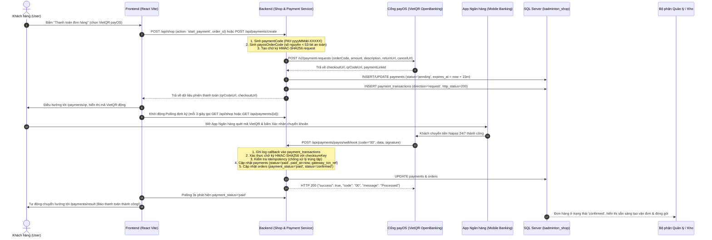
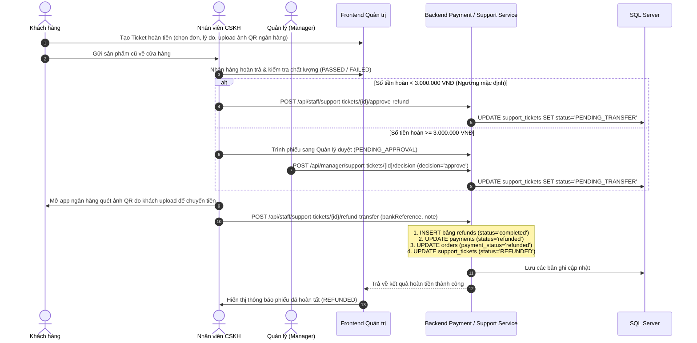

# LUỒNG HOẠT ĐỘNG MODULE THANH TOÁN (PAYMENT FLOW)
> **Dự án:** SBA301_BadmintonShop_SE1986-JV  
> **Cổng thanh toán:** payOS (VietQR Napas 24/7)  
> **Quyết định phạm vi (Scope Decision):** **LOẠI BỎ HOÀN TOÀN COD**. 100% đơn hàng online bắt buộc thanh toán trực tuyến qua payOS VietQR trước khi xuất kho giao hàng.  
> **Kiến trúc:** Java 21, Spring Boot 3, Spring Data JPA, Spring Security, SQL Server, RESTful Architecture (Chuẩn Zero `/v1/`: `/api/payments`)

---

## 1. TỔNG QUAN KIẾN TRÚC & CÁC PHƯƠNG THỨC THANH TOÁN

Hệ thống hỗ trợ 2 luồng thanh toán chính (loại bỏ hoàn toàn COD):
1. **payOS (VietQR Napas 24/7):** Thanh toán tự động 24/7 qua cổng OpenBanking. Khách quét mã VietQR bằng ứng dụng ngân hàng bất kỳ, Webhook tự động cập nhật đơn hàng sang `paid` và `confirmed` tức thì. Đơn hàng chỉ được đóng gói và giao đi khi đã thanh toán thành công.
2. **Refund (Hoàn tiền đổi trả thủ công qua quét QR):** Áp dụng khi đổi trả hàng (`support_tickets` - UC15), hỗ trợ hoàn tiền qua quét mã QR tài khoản ngân hàng của khách với phân quyền duyệt 2 cấp độ: `< 3.000.000 VNĐ` (`STAFF`) và $\ge$ 3.000.000 VNĐ (`MANAGER`).

---

## 2. CHI TIẾT CÁC LUỒNG HOẠT ĐỘNG (FLOWS & SEQUENCE DIAGRAMS)

### 2.1. Luồng 1: Thanh toán trực tuyến qua payOS (VietQR Flow)



---

### 2.2. Luồng 2: Xử lý Hoàn tiền đổi trả (Refund Flow - UC15 & UC13)



---

## 3. CƠ CHẾ BẢO MẬT VÀ XỬ LÝ LỖI TRONG LUỒNG THANH TOÁN

### 3.1. Xác thực chữ ký số Webhook (HMAC-SHA256)
* Khi payOS gửi dữ liệu qua Webhook, server sắp xếp các trường trong object `data` theo thứ tự chữ cái (canonical sorting) và tạo chuỗi query `key1=value1&key2=value2...`.
* Server tính mã băm HMAC-SHA256 của chuỗi trên với `PAYOS_CHECKSUM_KEY`.
* **Xác thực thành công:** Nếu mã băm khớp chính xác với `webhookRequest.getSignature()` $\rightarrow$ Tiến hành xử lý cập nhật đơn hàng.
* **Xác thực thất bại:** Nếu chữ ký không khớp $\rightarrow$ Bị từ chối ngay lập tức (`SecurityException`), trả về HTTP 400 và không cập nhật CSDL.

### 3.2. Cơ chế Idempotency (Chống xử lý trùng lặp giao dịch)
* Do đặc thù mạng Internet, payOS có cơ chế retry gửi lại Webhook nhiều lần nếu chưa nhận được phản hồi HTTP 200 kịp thời.
* Khi nhận Webhook, `PaymentServiceImpl` tra cứu bản ghi `Payment`:
  * Nếu `payment.getStatus().equalsIgnoreCase("paid")` $\rightarrow$ Hệ thống ghi log và **bỏ qua việc cập nhật lại**, trả về ngay `{ "success": true, "code": "00", "message": "Processed" }`.
  * Đảm bảo không xảy ra hiện tượng cộng tiền trùng lặp, không gửi thông báo trùng và không làm sai lệch tồn kho.

### 3.3. Thời hạn phiên thanh toán (Timeout & Expired)
* Mỗi link VietQR payOS có thời gian sống là **15 phút** (`expires_at = NOW + 15 phút`).
* Nếu quá 15 phút khách hàng không chuyển khoản:
  * Trạng thái thanh toán chuyển sang `expired`.
  * Đơn hàng tự động hủy (`status = 'cancelled'`) và hoàn lại số lượng tồn kho sản phẩm cho các khách hàng khác.

### 3.4. Bảo vệ các Endpoint trong Spring Security
* Endpoint Webhook `POST /api/payments/payos/webhook`: Mở công khai (`permitAll`) trong `SecurityConfig` để cổng thanh toán payOS có thể gọi tới, được bảo vệ nghiêm ngặt bằng chữ ký HMAC-SHA256.
* Endpoint xác thực Webhook URL `POST /api/payments/payos/confirm-webhook`: Yêu cầu quyền quản trị viên `ROLE_ADMIN`.
* Các endpoint tạo và tra cứu thanh toán thông thường: Yêu cầu người dùng đã xác thực token JWT (`authenticated()`).

---

## 4. BẢNG TRẠNG THÁI THANH TOÁN & ĐỒNG BỘ ĐƠN HÀNG

| Trạng thái `payments.status` | Trạng thái `orders.payment_status` | Trạng thái `orders.status` | Ý nghĩa nghiệp vụ |
| :--- | :--- | :--- | :--- |
| `pending` | `unpaid` | `pending` | Đơn hàng vừa tạo, đang chờ khách quét VietQR trong 15 phút |
| `paid` | `paid` | `confirmed` | Khách đã chuyển khoản thành công qua payOS. Đơn hàng chuyển sang chuẩn bị & giao |
| `failed` | `unpaid` | `pending` | Giao dịch qua cổng bị lỗi, khách có thể chọn phương thức khác hoặc tạo lại mã |
| `expired` | `unpaid` | `cancelled` | Hết 15 phút khách không trả tiền, đơn bị hủy và nhả kho tự động |
| `cancelled` | `unpaid` | `cancelled` | Khách chủ động hủy yêu cầu thanh toán |
| `refunded` | `refunded` | `returned` / `completed` | Đã xử lý hoàn tiền lại cho khách hàng sau khi duyệt ticket |

---

## 5. DANH MỤC API ENDPOINTS MODULE THANH TOÁN (ZERO `/v1/`)

| Method | Endpoint | Mục đích | Quyền truy cập |
| :--- | :--- | :--- | :--- |
| `POST` | `/api/payments/create` | Tạo phiên thanh toán payOS VietQR độc lập | Authenticated User |
| `GET` | `/api/payments/{id}` | Tra cứu trạng thái thanh toán theo ID (Polling 3s) | Authenticated User |
| `GET` | `/api/payments/by-code/{code}` | Tra cứu theo mã nội bộ `PAY-yyyyMMdd-XXXXX` | Authenticated User |
| `GET` | `/api/payments/by-payos-code/{code}` | Tra cứu theo mã số nguyên payOS (`payosOrderCode`) | Authenticated User |
| `GET` | `/api/payments/order/{orderId}` | Xem lịch sử các lần thanh toán của một đơn hàng | Authenticated User |
| `POST` | `/api/payments/{id}/cancel` | Hủy link thanh toán đang mở | Authenticated User |
| `POST` | `/api/payments/payos/webhook` | Cổng payOS bắn Webhook thông báo tự động | Public (Xác thực HMAC-SHA256) |
| `POST` | `/api/payments/payos/confirm-webhook` | Gửi yêu cầu xác thực Webhook URL tới cổng payOS | `ROLE_ADMIN` |
| `POST` | `/api/shop` | Gửi action `{ type: 'start_payment', order_id, gateway }` từ Frontend | Authenticated User |
| `POST` | `/api/staff/support-tickets/{id}/approve-refund` | Duyệt hoàn tiền khoản < 3.000.000 VNĐ | `ROLE_STAFF`, `ROLE_MANAGER`, `ROLE_ADMIN` |
| `POST` | `/api/manager/support-tickets/{id}/decision` | Thẩm định & Duyệt hoàn tiền $\ge$ 3.000.000 VNĐ | `ROLE_MANAGER`, `ROLE_ADMIN` |
| `POST` | `/api/staff/support-tickets/{id}/refund-transfer` | Ghi nhận chuyển khoản thủ công sau khi quét QR | `ROLE_STAFF`, `ROLE_MANAGER`, `ROLE_ADMIN` |

---

## 6. HƯỚNG DẪN TEST MOCK TOÀN BỘ LUỒNG (POSTMAN & CURL)

### Bước 1: Tạo phiên thanh toán (Tạo mã QR / Link)
```bash
curl -X POST http://localhost:8080/api/payments/create \
  -H "Content-Type: application/json" \
  -H "Authorization: Bearer <JWT_TOKEN>" \
  -d '{
    "orderId": 1,
    "amount": 1500000,
    "description": "Vot Yonex Astrox 88D",
    "buyerName": "Nguyen Van A",
    "buyerEmail": "a.nguyen@example.com",
    "buyerPhone": "0912345678"
  }'
```
*Nhận về `payosOrderCode` (ví dụ: `5567891234`) và `checkoutUrl`, `qrCodeUrl`.*

### Bước 2: Giả lập Webhook payOS báo chuyển khoản thành công
```bash
curl -X POST http://localhost:8080/api/payments/payos/webhook \
  -H "Content-Type: application/json" \
  -d '{
    "code": "00",
    "desc": "success",
    "data": {
      "orderCode": 5567891234,
      "amount": 1500000,
      "description": "Vot Yonex Astrox 88D",
      "accountNumber": "1903678910",
      "reference": "FT2610318899",
      "currency": "VND",
      "code": "00"
    },
    "signature": "d682498522646c05dbb320d75a34e0622e03fcba0bf3e0f9b378033ee9bc27a9"
  }'
```

### Bước 3: Tra cứu trạng thái thanh toán đã sang `paid`
```bash
curl http://localhost:8080/api/payments/1 \
  -H "Authorization: Bearer <JWT_TOKEN>"
```
*Trường `status` sẽ trả về `"paid"` và `gatewayTxnRef` là `"FT2610318899"`.*
