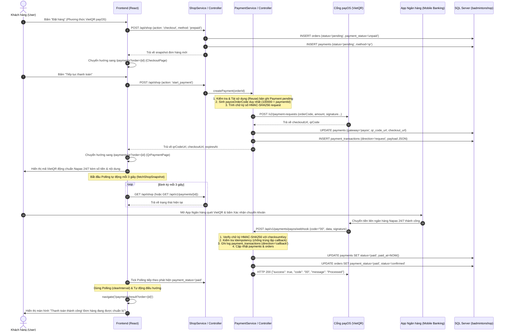
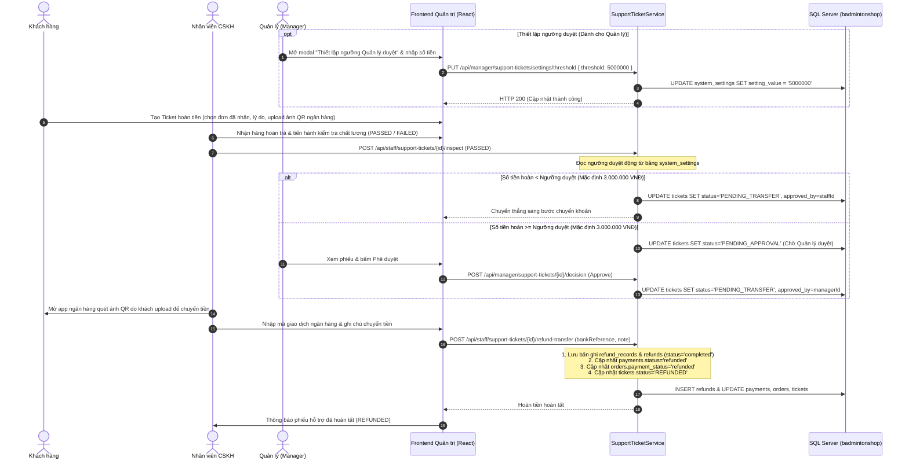

# LUỒNG HOẠT ĐỘNG MODULE THANH TOÁN (PAYMENT FLOW)
> **Dự án:** SBA301_BadmintonShop_SE1986-JV  
> **Cổng thanh toán:** payOS (VietQR Napas 24/7)  
> **Quyết định phạm vi (Scope Decision):**  
> 1. **LOẠI BỎ HOÀN TOÀN COD:** 100% đơn hàng online bắt buộc thanh toán trực tuyến qua payOS VietQR trước khi xác nhận đơn và xuất kho giao hàng.  
> 2. **LOẠI BỎ PAYOUT API TỰ ĐỘNG:** Áp dụng phương án Hoàn tiền thủ công quét mã QR ngân hàng (Manual QR Transfer) theo phân quyền duyệt linh hoạt < Ngưỡng (Staff) và $\ge$ Ngưỡng (Manager).  
> 3. **QUẢN LÝ CẤU HÌNH NGƯỠNG DUYỆT LINH HOẠT:** Ngưỡng phê duyệt (mặc định 3.000.000 VNĐ) được lưu trong bảng `system_settings` và Quản lý (`MANAGER`) có thể điều chỉnh trực tiếp trên hệ thống.  
> **Kiến trúc:** Java 21, Spring Boot 3, Spring Data JPA, Spring Security, SQL Server, React 19 (Vite)

---

## 1. TỔNG QUAN KIẾN TRÚC & CÁC PHƯƠNG THỨC THANH TOÁN

Hệ thống hỗ trợ 2 luồng nghiệp vụ thanh toán chính thức:
1. **payOS (VietQR Napas 24/7):** Thanh toán tự động 24/7 qua cổng OpenBanking. Khách quét mã VietQR bằng ứng dụng ngân hàng bất kỳ, Webhook tự động cập nhật đơn hàng sang `paid` và `confirmed` trong vòng vài giây. Frontend tự động Polling định kỳ mỗi 3 giây để chuyển hướng ngay khi giao dịch thành công.
2. **Refund (Hoàn tiền thủ công qua quét QR tài khoản khách):** Áp dụng khi đổi trả hàng (`support_tickets` - UC15), hỗ trợ hoàn tiền qua quét mã QR tài khoản ngân hàng của khách với phân quyền duyệt < Ngưỡng (`STAFF`) và $\ge$ Ngưỡng (`MANAGER`), trong đó Ngưỡng hoàn tiền do Quản lý (`MANAGER`) cấu hình động trên hệ thống (lưu bảng `system_settings`).

---

## 2. CHI TIẾT CÁC LUỒNG HOẠT ĐỘNG (FLOWS & SEQUENCE DIAGRAMS)

### 2.1. Luồng 1: Thanh toán trực tuyến qua payOS (VietQR Flow) & Polling tự động



---

### 2.2. Luồng 2: Xử lý Hoàn tiền đổi trả (Refund Flow - UC15) & Thiết lập ngưỡng Quản lý



---

## 3. CÁC CƠ CHẾ BẢO MẬT VÀ TỐI ƯU HÓA KỸ THUẬT

### 3.1. Xác thực chữ ký số Webhook (HMAC-SHA256)
* Khi payOS gửi Webhook sang backend:
  1. Backend trích xuất object `data` từ payload.
  2. Sắp xếp toàn bộ các thuộc tính của `data` theo thứ tự chữ cái A-Z (`canonical alphabet sorting`).
  3. Băm chuỗi dữ liệu chuẩn hóa bằng thuật toán `HmacSHA256` với khóa bí mật `PAYOS_CHECKSUM_KEY`.
  4. Đối chiếu mã băm tính được với trường `signature` của webhook.
  5. Nếu không khớp $\rightarrow$ Ngay lập tức từ chối HTTP 400 Bad Request, ghi log cảnh báo và không thay đổi dữ liệu đơn hàng.

### 3.2. Cơ chế Idempotency (Chống xử lý trùng lặp giao dịch)
* Khi nhận webhook callback, `PaymentServiceImpl` tra cứu trạng thái phiên thanh toán:
  * Nếu `payment.getStatus().equalsIgnoreCase("paid")`: Hệ thống ghi log thông tin và **bỏ qua cập nhật trùng lặp**, lập tức trả về HTTP 200 `{ "success": true, "code": "00", "message": "Processed" }`.
  * Đảm bảo tính bất biến: webhook có thể gửi retry nhiều lần do mạng chập chờn mà không bao giờ gây duplicate trừ kho, cộng tiền hoặc gửi thông báo 2 lần.

### 3.3. Cơ chế Tái sử dụng phiên thanh toán (Payment Session Reuse)
* **Khắc phục lỗi tạo thừa bản ghi:**
  * Khi `createPayment(request)` được gọi, hệ thống kiểm tra `paymentRepository.findFirstByOrderIdAndStatusOrderByCreatedAtDesc(orderId, "pending")`.
  * Nếu đơn hàng đã có bản ghi `Payment` đang ở trạng thái `pending`:
    * Hệ thống **tái sử dụng chính bản ghi đó**, cập nhật `method = "qr"`, `gateway = "payos"`.
    * Nếu bản ghi đã có mã VietQR và link còn hạn (< 14 phút), hệ thống trả về ngay link cũ mà không gọi lại API payOS (tránh lỗi duplicate `orderCode` của payOS).
    * Nếu bản ghi chưa có mã QR (vừa được tạo khi checkout), hệ thống sinh `payosOrderCode = 100000L + payment.getId()` (duy nhất tuyệt đối), gọi payOS lấy link và lưu vào bản ghi đó.
  * Chỉ khi phiên thanh toán cũ đã bị hủy (`cancelled`), hết hạn (`expired`), hoặc lỗi (`failed`), khi khách bấm "Thanh toán lại" (Retry), hệ thống mới tạo 1 bản ghi `Payment` mới để lưu vết lịch sử phục vụ đối soát.

### 3.4. Cơ chế Polling tự động định kỳ 3 giây ở Frontend
* Trên hook [`usePayment.js`](file:///d:/_Ky7-FPTU/SBA301/gr_project/SBA301_BadmintonShop_SE1986-JV/frontend/src/modules/payment/hooks/usePayment.js):
  * Khi mở màn hình QR (`QrPaymentPage`), timer tự động kích hoạt chu kỳ 3000ms.
  * Khi tiền về tài khoản shop và Webhook cập nhật DB thành công $\rightarrow$ Lần poll tiếp theo phát hiện `payment_status === 'paid'`, tự động hủy timer và chuyển hướng ngay sang trang kết quả `/payments/result?order={id}`.
  * Có cơ chế tự động dọn dẹp timer khi component unmount hoặc khi đơn bị cancelled/expired.

### 3.5. Tự động nạp biến môi trường (`.env Loader`)
* Trong [`BadmintonshopApplication.java`](file:///d:/_Ky7-FPTU/SBA301/gr_project/SBA301_BadmintonShop_SE1986-JV/backend/badmintonshop/src/main/java/fu/se/badmintonshop/BadmintonshopApplication.java):
  * Tích hợp hàm `loadDotEnv()` chạy trước khi khởi tạo Spring Boot.
  * Tự động nạp các biến `PAYOS_CLIENT_ID`, `PAYOS_API_KEY`, `PAYOS_CHECKSUM_KEY`, `SPRING_DATASOURCE_*` từ file `.env` vào System Properties.
  * Spring Boot tự động đưa các biến này vào [`application.properties`](file:///d:/_Ky7-FPTU/SBA301/gr_project/SBA301_BadmintonShop_SE1986-JV/backend/badmintonshop/src/main/resources/application.properties) mà không cần cấu hình tay trên IDE.

### 3.6. Thời hạn phiên thanh toán & Tự động hủy đơn (Scheduler Timeout)
* Mỗi link payOS có thời hạn 15 phút.
* [`PaymentTimeoutScheduler.java`](file:///d:/_Ky7-FPTU/SBA301/gr_project/SBA301_BadmintonShop_SE1986-JV/backend/badmintonshop/src/main/java/fu/se/badmintonshop/modules/payment/scheduler/PaymentTimeoutScheduler.java) chạy định kỳ mỗi 60 giây quét các payment `pending` quá 15 phút:
  * Chuyển `payments.status = 'expired'`.
  * Nếu đơn hàng vẫn ở trạng thái `unpaid` và `pending`, tự động chuyển `orders.status = 'cancelled'` để nhả số lượng tồn kho sản phẩm cho khách hàng khác mua.

---

## 4. BẢNG TRẠNG THÁI THANH TOÁN VÀ ĐỒNG BỘ ĐƠN HÀNG

| Trạng thái `payments.status` | Trạng thái `orders.payment_status` | Trạng thái `orders.status` | Ý nghĩa nghiệp vụ |
| :--- | :--- | :--- | :--- |
| `pending` | `unpaid` | `pending` | Đơn hàng vừa tạo, đang chờ khách quét VietQR trong 15 phút |
| `paid` | `paid` | `confirmed` | Khách đã chuyển khoản thành công qua payOS. Đơn hàng sẵn sàng đóng gói & giao |
| `failed` | `unpaid` | `pending` | Giao dịch qua cổng bị lỗi, khách có thể bấm "Thanh toán lại" |
| `expired` | `unpaid` | `cancelled` | Hết 15 phút khách không trả tiền, đơn bị hủy và nhả kho tự động |
| `cancelled` | `unpaid` | `cancelled` | Khách chủ động hủy yêu cầu thanh toán |
| `refunded` | `refunded` | `returned` / `completed` | Đã xử lý hoàn tiền lại cho khách hàng sau khi duyệt ticket |

---

## 5. DANH MỤC API ENDPOINTS HOÀN CHỈNH

| Method | Endpoint | Mục đích | Quyền truy cập |
| :--- | :--- | :--- | :--- |
| `POST` | `/api/v1/payments/create` | Tạo phiên thanh toán payOS VietQR (Tái sử dụng phiên pending nếu có) | Authenticated User |
| `GET` | `/api/v1/payments/{id}` | Tra cứu trạng thái thanh toán theo Payment ID (Polling) | Authenticated User |
| `GET` | `/api/v1/payments/by-code/{code}` | Tra cứu theo mã thanh toán nội bộ `PAY-yyyyMMdd-XXXXX` | Authenticated User |
| `GET` | `/api/v1/payments/by-payos-code/{code}` | Tra cứu theo mã số nguyên `payosOrderCode` | Authenticated User |
| `GET` | `/api/v1/payments/order/{orderId}` | Lịch sử các lần thử thanh toán của một đơn hàng | Authenticated User |
| `POST` | `/api/v1/payments/{id}/cancel` | Hủy link thanh toán | Authenticated User |
| `POST` | `/api/v1/payments/payos/webhook` | Cổng payOS bắn Webhook thông báo kết quả (Bảo vệ HMAC-SHA256) | Public (`permitAll`) |
| `POST` | `/api/v1/payments/payos/confirm-webhook`| Xác thực Webhook URL khi đăng ký cổng payOS | Admin (`hasRole('ADMIN')`) |
| `GET` | `/api/manager/support-tickets/settings/threshold` | Xem ngưỡng phê duyệt hoàn tiền hiện tại của hệ thống | Manager / Admin |
| `PUT` | `/api/manager/support-tickets/settings/threshold` | Cập nhật ngưỡng phê duyệt hoàn tiền linh hoạt | Manager / Admin |
| `POST` | `/api/staff/support-tickets/{id}/approve-refund` | Duyệt hoàn tiền khoản < Ngưỡng xét duyệt | Staff |
| `POST` | `/api/manager/support-tickets/{id}/decision` | Thẩm định & Phê duyệt khoản hoàn $\ge$ Ngưỡng xét duyệt | Manager |
| `POST` | `/api/staff/support-tickets/{id}/refund-transfer` | Ghi nhận mã giao dịch chuyển khoản thủ công sau khi quét QR | Staff |

---

## 6. HƯỚNG DẪN KIỂM THỬ MOCK LUỒNG (POSTMAN / CURL)

### Bước 1: Tạo phiên thanh toán (Tạo mã QR / Link)
```bash
curl -X POST http://localhost:8080/api/v1/payments/create \
  -H "Content-Type: application/json" \
  -H "Authorization: Bearer <JWT_TOKEN>" \
  -d '{
    "orderId": 105,
    "amount": 1500000,
    "description": "Vot Yonex Astrox 88D",
    "buyerName": "Nguyen Van A",
    "buyerEmail": "a.nguyen@example.com",
    "buyerPhone": "0912345678"
  }'
```
*Nhận về `paymentId`, `payosOrderCode` (ví dụ: `100201`), `checkoutUrl` và `qrCodeUrl`.*

### Bước 2: Giả lập Webhook payOS báo chuyển khoản thành công
```bash
curl -X POST http://localhost:8080/api/v1/payments/payos/webhook \
  -H "Content-Type: application/json" \
  -d '{
    "code": "00",
    "desc": "success",
    "data": {
      "orderCode": 100201,
      "amount": 1500000,
      "description": "Vot Yonex Astrox 88D",
      "accountNumber": "1903678910",
      "reference": "FT2611078899",
      "currency": "VND",
      "code": "00"
    },
    "signature": "<HMAC_SHA256_SIGNATURE>"
  }'
```

### Bước 3: Kiểm tra trạng thái thanh toán đã sang `paid`
```bash
curl -X GET http://localhost:8080/api/v1/payments/201 \
  -H "Authorization: Bearer <JWT_TOKEN>"
```
*Trường `status` sẽ trả về `"paid"` và `gatewayTxnRef` là mã giao dịch ngân hàng `"FT2611078899"`.*

### Bước 4: Kiểm tra và thay đổi ngưỡng phê duyệt hoàn tiền (Manager)
```bash
# Xem ngưỡng hiện tại
curl -X GET http://localhost:8080/api/manager/support-tickets/settings/threshold \
  -H "Authorization: Bearer <MANAGER_JWT_TOKEN>"

# Cập nhật ngưỡng mới thành 5.000.000 VNĐ
curl -X PUT http://localhost:8080/api/manager/support-tickets/settings/threshold \
  -H "Content-Type: application/json" \
  -H "Authorization: Bearer <MANAGER_JWT_TOKEN>" \
  -d '{
    "threshold": 5000000
  }'
```
