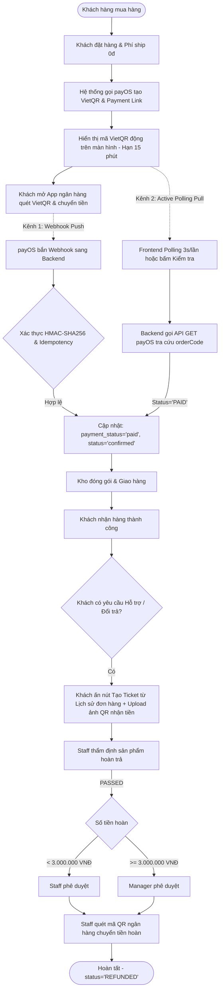

# TỔNG QUAN NGHIỆP VỤ THANH TOÁN (PAYMENT) & PHƯƠNG ÁN THỰC THI CHÍNH THỨC
> **Dự án:** Badminton Shop Management System (SBA301_BadmintonShop_SE1986-JV)  
> **Công nghệ:** Java 21, Spring Boot 3, React (Vite), SQL Server, payOS (VietQR Napas 24/7)  
> **Quyết định phạm vi (Scope Decision):**  
> 1. **BỎ HOÀN TOÀN COD (Cash On Delivery):** 100% đơn hàng online bắt buộc thanh toán trả trước qua cổng thanh toán payOS (VietQR) trước khi xuất kho.  
> 2. **PHÍ VẬN CHUYỂN MẶC ĐỊNH 0Đ (FREESHIP):** Áp dụng miễn phí vận chuyển toàn quốc cho mọi đơn hàng.  
> 3. **CƠ CHẾ ĐỐI SOÁT KÉP (DUAL VERIFICATION):** Kết hợp Webhook thụ động từ payOS và Active Polling Sync (Chủ động tra cứu payOS API), đảm bảo không bao giờ bị miss giao dịch (hoạt động hoàn hảo cả trên Localhost không cần ngrok và Production). *(Xem tài liệu chuyên đề: [**`webhook-and-ngrok.md`**](webhook-and-ngrok.md))*.  
> 4. **BỎ TỰ ĐỘNG HOÀN TIỀN PAYOUT API:** Áp dụng phương án Hoàn tiền thủ công quét mã QR ngân hàng (Manual QR Transfer) theo phân quyền duyệt < 3M (Staff) và $\ge$ 3M (Manager).  
> 5. **LIÊN KẾT ĐỔI TRẢ TRỰC TIẾP TỪ ĐƠN HÀNG:** Đơn hàng đã thanh toán (`payment_status = 'paid'`) có nút tạo Support Ticket trực tiếp từ trang Lịch sử mua sắm.

---

## 1. BỐI CẢNH & HIỆN TRẠNG HỆ THỐNG

Hệ thống SBA301 Badminton Shop là nền tảng thương mại điện tử chuyên biệt cho sản phẩm cầu lông (vợt, giày, phụ kiện, đan cước) kết hợp quản lý kho, giao vận và hỗ trợ sau bán hàng (đổi trả, bảo hành).

### 1.1. Hiện trạng triển khai mã nguồn
1. **Frontend (React Vite):**
   - Đã xây dựng các trang thanh toán & đơn hàng:
     - [`CheckoutPage.jsx`](file:///d:/_Ky7-FPTU/SBA301/gr_project/SBA301_BadmintonShop_SE1986-JV/frontend/src/modules/payment/pages/CheckoutPage.jsx): Mặc định chọn Chuyển khoản VietQR payOS. Phí ship mặc định 0đ.
     - [`QrPaymentPage.jsx`](file:///d:/_Ky7-FPTU/SBA301/gr_project/SBA301_BadmintonShop_SE1986-JV/frontend/src/modules/payment/pages/QrPaymentPage.jsx): Hiển thị mã VietQR động từ payOS, số tiền và nội dung chuyển khoản tự động. Nút *"Kiểm tra kết quả giao dịch"* chủ động kích hoạt API đồng bộ trạng thái với payOS.
     - [`PaymentResultPage.jsx`](file:///d:/_Ky7-FPTU/SBA301/gr_project/SBA301_BadmintonShop_SE1986-JV/frontend/src/modules/payment/pages/PaymentResultPage.jsx): Hiển thị kết quả thanh toán, tự động kích hoạt làm mới dữ liệu cửa hàng (`refresh()`).
     - [`OrdersPage.jsx`](file:///d:/_Ky7-FPTU/SBA301/gr_project/SBA301_BadmintonShop_SE1986-JV/frontend/src/modules/shop/pages/OrdersPage.jsx): Tự động làm mới dữ liệu khi mở trang, hiển thị trạng thái "Đã thanh toán" / "Chưa thanh toán", có nút **"Tạo phiếu hỗ trợ / Đổi trả"** (khi đã thanh toán) hoặc **"Xem phiếu hỗ trợ"** (nếu đã có ticket).
     - [`CreateSupportTicketPage.jsx`](file:///d:/_Ky7-FPTU/SBA301/gr_project/SBA301_BadmintonShop_SE1986-JV/frontend/src/modules/support/pages/CreateSupportTicketPage.jsx): Nhận `orderId` từ URL params để tự động chọn đơn hàng và sản phẩm cần đổi trả/hoàn tiền.
   - Có cơ chế **Active Polling đồng bộ trạng thái** định kỳ mỗi 3 giây khi khách mở màn hình QR.
   - Các route thanh toán được bảo vệ bởi [`ProtectedRoute`](file:///d:/_Ky7-FPTU/SBA301/gr_project/SBA301_BadmintonShop_SE1986-JV/frontend/src/app/router/ProtectedRoute.jsx) yêu cầu người dùng phải đăng nhập tài khoản.
2. **Cơ sở dữ liệu (SQL Server - `badminton_shop.sql`):**
   - Bảng [`payments`](file:///d:/_Ky7-FPTU/SBA301/gr_project/SBA301_BadmintonShop_SE1986-JV/badminton_shop.sql#L394): Quản lý phiên thanh toán (`method = 'qr'`, `status`, `amount`, `gateway_txn_ref`, `qr_code_url`).
   - Bảng [`payment_transactions`](file:///d:/_Ky7-FPTU/SBA301/gr_project/SBA301_BadmintonShop_SE1986-JV/badminton_shop.sql#L412): Lưu vết toàn bộ log request, response, webhook callback (chuỗi JSON phục vụ đối soát, tra soát).
   - Bảng [`refunds`](file:///d:/_Ky7-FPTU/SBA301/gr_project/SBA301_BadmintonShop_SE1986-JV/badminton_shop.sql#L422): Lưu trữ các lệnh hoàn tiền gắn với ticket đổi trả (`ticket_id`).
   - Bảng [`shipments`](file:///d:/_Ky7-FPTU/SBA301/gr_project/SBA301_BadmintonShop_SE1986-JV/badminton_shop.sql#L450): Do bỏ COD, trường `cod_amount` luôn bằng 0, không phát sinh nghiệp vụ thu hộ tiền mặt. Phí vận chuyển mặc định 0đ.
3. **Backend (Spring Boot):**
   - Package `fu.se.badmintonshop.modules.payment`:
     - [`PayOSServiceImpl.java`](file:///d:/_Ky7-FPTU/SBA301/gr_project/SBA301_BadmintonShop_SE1986-JV/backend/badmintonshop/src/main/java/fu/se/badmintonshop/modules/payment/service/impl/PayOSServiceImpl.java): Tích hợp tạo Payment Link, xác thực chữ ký HMAC-SHA256 và tra cứu trạng thái giao dịch trực tiếp qua API payOS `GET /v2/payment-requests/{orderCode}`.
     - [`PaymentServiceImpl.java`](file:///d:/_Ky7-FPTU/SBA301/gr_project/SBA301_BadmintonShop_SE1986-JV/backend/badmintonshop/src/main/java/fu/se/badmintonshop/modules/payment/service/impl/PaymentServiceImpl.java): Xử lý Webhook, kiểm tra Idempotency, đồng bộ trạng thái đơn hàng (`markPaymentAsPaid`), hỗ trợ đối soát chủ động (`syncPaymentStatus`, `syncPendingPayments`).
     - [`PaymentTimeoutScheduler.java`](file:///d:/_Ky7-FPTU/SBA301/gr_project/SBA301_BadmintonShop_SE1986-JV/backend/badmintonshop/src/main/java/fu/se/badmintonshop/modules/payment/scheduler/PaymentTimeoutScheduler.java): Quét và tự động hủy đơn sau 15 phút không thanh toán.
   - Package `fu.se.badmintonshop.modules.shop`:
     - [`ShopService.java`](file:///d:/_Ky7-FPTU/SBA301/gr_project/SBA301_BadmintonShop_SE1986-JV/backend/badmintonshop/src/main/java/fu/se/badmintonshop/modules/shop/ShopService.java): Đặt phí ship mặc định 0đ, tự động gọi `syncPendingPayments()` khi lấy snapshot để đồng bộ trạng thái ngay trong vòng lặp Polling.
     - [`SupportActions.java`](file:///d:/_Ky7-FPTU/SBA301/gr_project/SBA301_BadmintonShop_SE1986-JV/backend/badmintonshop/src/main/java/fu/se/badmintonshop/modules/shop/SupportActions.java): Cho phép tạo ticket hỗ trợ cho mọi đơn hàng đã thanh toán hợp lệ (`payment_status = 'paid'`).

---

## 2. QUY TRÌNH NGHIỆP VỤ THANH TOÁN & ĐỐI SOÁT KÉP (DUAL VERIFICATION)



### 2.1. Nghiệp vụ 1: Thanh toán trực tuyến 100% qua payOS VietQR (Dual Verification)
- **Nguyên tắc cốt lõi:** Đơn hàng chỉ được xác nhận (`status = 'confirmed'`) và xuất kho khi tiền đã thực sự về tài khoản cửa hàng (`payment_status = 'paid'`).
- **Quy trình chi tiết:**
  1. **Tạo phiên thanh toán:** Khi khách bấm "Đặt hàng", Backend gọi API v2 của cổng payOS (`/v2/payment-requests`), tạo mã VietQR kèm link thanh toán. Phiên có hạn 15 phút (`expires_at = now + 15m`). Phí vận chuyển mặc định tính là 0đ.
  2. **Trải nghiệm khách hàng:** 
     - Khách hàng không cần nhập thông tin tài khoản hay số tiền.
     - Màn hình hiển thị mã VietQR động chuẩn Napas 24/7. Khách mở ứng dụng ngân hàng bất kỳ quét mã và xác nhận chuyển tiền.
  3. **Cơ chế xác nhận kép (Dual Verification):**
     - **Kênh 1 (Webhook Push):** Ngay khi tiền vào tài khoản, payOS bắn tín hiệu **Webhook** sang Backend. Backend xác thực chữ ký bảo mật **HMAC-SHA256**, kiểm tra **Idempotency** và cập nhật `payments.status = 'paid'`, `orders.payment_status = 'paid'`, `orders.status = 'confirmed'`.
     - **Kênh 2 (Active Polling Pull - Fail-safe):** Trong lúc khách mở màn hình QR, Frontend gọi polling định kỳ 3 giây/lần. Backend tự động gọi API `GET /v2/payment-requests/{orderCode}` của payOS để đối soát trạng thái. Ngay khi payOS báo `status == "PAID"`, Backend tự động cập nhật đơn hàng thành `paid`. Kênh này đảm bảo hệ thống tự cập nhật mượt mà ngay cả khi Webhook bị lag, mạng chập chờn hoặc khi chạy dev trên Localhost mà không cần mở ngrok tunnel.
  4. **Cập nhật giao diện:** Frontend nhận trạng thái `paid` lập tức chuyển sang màn hình thông báo thanh toán thành công và đồng bộ lại danh sách đơn hàng.
  5. **Quản lý hết hạn (Timeout):** Nếu sau 15 phút khách không chuyển tiền, hệ thống chuyển giao dịch sang `expired`, tự động hủy đơn và nhả số lượng tồn kho sản phẩm cho khách khác.

### 2.2. Nghiệp vụ 2: Hỗ trợ sau bán hàng & Hoàn tiền (Support Tickets - UC15)
- **Nguyên tắc cốt lõi:** Bán tự động (Manual QR Transfer). Không gọi API trừ ví tự động, đảm bảo an toàn tài chính.
- **Quy trình chi tiết:**
  1. **Khách hàng tạo yêu cầu trực tiếp:** Trên trang Lịch sử mua sắm (`/orders`), mỗi đơn hàng đã thanh toán (`payment_status = 'paid'`) đều có nút **"Tạo phiếu hỗ trợ / Đổi trả"** dẫn thẳng tới `/support-tickets/create?orderId={id}` (tự động chọn đơn hàng và nạp danh sách sản phẩm).
  2. **Thẩm định hàng trả về:** Khách gửi sản phẩm cũ về shop. Nhân viên kiểm tra:
     - Nếu `FAILED`: Từ chối hoàn tiền, gửi trả sản phẩm cho khách.
     - Nếu `PASSED`: Hệ thống tính toán chính xác số tiền hoàn.
  3. **Phân quyền xét duyệt 2 cấp độ:**
     - **Khoản hoàn < 3.000.000 VNĐ:** Nhân viên CSKH (`STAFF`) trực tiếp duyệt (`approveRefund`).
     - **Khoản hoàn $\ge$ 3.000.000 VNĐ:** Chuyển Quản lý (`MANAGER`) phê duyệt (`managerDecision`).
  4. **Thực hiện chuyển khoản:** Nhân viên quét ảnh mã QR do khách upload, chuyển đúng số tiền đã duyệt, nhập mã giao dịch ngân hàng (Bank Reference) vào hệ thống để chuyển ticket sang `REFUNDED`.

---

## 3. BẢNG TRẠNG THÁI THANH TOÁN & ĐỒNG BỘ ĐƠN HÀNG

| Trạng thái `payments.status` | Trạng thái `orders.payment_status` | Trạng thái `orders.status` | Ý nghĩa nghiệp vụ |
| :--- | :--- | :--- | :--- |
| `pending` | `unpaid` | `pending` | Đơn hàng vừa tạo, đang chờ khách quét VietQR trong 15 phút |
| `paid` | `paid` | `confirmed` | Đã nhận thanh toán (qua Webhook hoặc Active Sync). Đơn sẵn sàng đóng gói |
| `expired` | `unpaid` | `cancelled` | Quá 15 phút khách không chuyển tiền. Tự hủy đơn và nhả tồn kho |
| `cancelled` | `unpaid` | `cancelled` | Khách chủ động hủy yêu cầu thanh toán |
| `failed` | `unpaid` | `pending` | Giao dịch qua cổng lỗi, khách có thể tạo lại mã QR |
| `refunded` | `refunded` | `returned` / `completed` | Đã hoàn tất chuyển khoản tiền trả lại cho khách sau khi duyệt ticket |

---

## 4. ĐẶC TẢ DANH MỤC API THANH TOÁN (ZERO `/v1/`)

```http
### 1. Tạo phiên thanh toán VietQR (Online Checkout)
POST /api/payments/create
Content-Type: application/json

{
  "orderId": 105,
  "amount": 2500000,
  "description": "Thanh toan don hang #105",
  "buyerName": "Nguyen Van A",
  "buyerEmail": "a.nguyen@example.com",
  "buyerPhone": "0912345678"
}

Response (200 OK):
{
  "success": true,
  "data": {
    "paymentId": 201,
    "paymentCode": "PAY-20261101-00201",
    "payosOrderCode": 987654321,
    "checkoutUrl": "https://pay.payos.vn/web/...",
    "qrCodeUrl": "https://img.vietqr.io/image/...",
    "expiresAt": "2026-11-01T14:30:00Z"
  }
}
```

```http
### 2. Tra cứu trạng thái thanh toán theo ID (Polling)
GET /api/payments/201

Response (200 OK):
{
  "success": true,
  "data": {
    "id": 201,
    "orderId": 105,
    "status": "paid",
    "gatewayTxnRef": "FT2611018899",
    "paidAt": "2026-11-01T14:18:25Z"
  }
}
```

```http
### 3. Chủ động đối soát trực tiếp từ payOS theo Payment ID (Active Sync)
GET /api/payments/201/sync

Response (200 OK):
{
  "success": true,
  "data": {
    "id": 201,
    "orderId": 105,
    "status": "paid",
    "gatewayTxnRef": "FT2611018899",
    "paidAt": "2026-11-01T14:18:25Z"
  }
}
```

```http
### 4. Chủ động đối soát trực tiếp từ payOS theo Order ID (Active Sync)
GET /api/payments/order/105/sync

Response (200 OK):
{
  "success": true,
  "data": {
    "id": 201,
    "orderId": 105,
    "status": "paid",
    "gatewayTxnRef": "FT2611018899"
  }
}
```

```http
### 5. Nhận Webhook tự động từ payOS (Server-to-Server Callback)
POST /api/payments/payos/webhook
Content-Type: application/json

{
  "code": "00",
  "desc": "success",
  "data": {
    "orderCode": 987654321,
    "amount": 2500000,
    "description": "Thanh toan don hang #105",
    "accountNumber": "1903678910",
    "reference": "FT2611018899",
    "currency": "VND",
    "code": "00"
  },
  "signature": "a5d8b... (HMAC-SHA256 signature tính từ data và checksumKey)"
}

Response (200 OK):
{
  "success": true,
  "code": "00",
  "message": "Processed"
}
```

```http
### 6. Ghi nhận hoàn tiền thủ công sau khi duyệt ticket (Staff/Manager)
POST /api/staff/support-tickets/{ticketId}/refund-transfer
Headers: X-User-Id: 2 (Staff ID)
Content-Type: application/json

{
  "transactionReference": "FT2611019900",
  "note": "Da chuyen khoan hoan tien qua anh QR cua khach"
}

Response (200 OK):
{
  "success": true,
  "message": "Đã ghi nhận chuyển khoản hoàn tiền thành công"
}
```

---

## 5. TỔNG KẾT TRIỂN KHAI VÀ BẢO ĐẢM KỸ THUẬT

1. **Frontend:**
   - Đã loại bỏ hoàn toàn COD, chọn VietQR làm phương thức thanh toán trả trước mặc định.
   - Phí vận chuyển mặc định 0đ hiển thị đồng bộ tại Cart, Order, Header và Checkout.
   - Thêm nút tạo Support Ticket trực tiếp từ `OrdersPage` khi đơn hàng `payment_status = 'paid'`, tự động truyền `orderId` sang màn hình tạo phiếu.
   - Đồng bộ state tự động: `OrdersPage`, `PaymentResultPage` và `usePayment` tự gọi `refresh()` để luôn hiển thị đơn hàng mới nhất từ database.
2. **Backend:**
   - Tích hợp chuẩn REST API payOS v2 và xác thực HMAC-SHA256.
   - Triển khai thành công **Cơ chế đối soát kép (Dual Verification)**: Webhook + Active Polling Sync qua `GET /v2/payment-requests/{orderCode}`, bảo đảm không bao giờ sót trạng thái giao dịch.
   - Quản lý vòng đời đơn hàng và tự động giải phóng tồn kho khi quá hạn 15 phút (`PaymentTimeoutScheduler`).
   - Phân quyền duyệt hoàn tiền chặt chẽ theo hạn mức: `< 3.000.000 VNĐ` (`STAFF`) và $\ge 3.000.000 VNĐ` (`MANAGER`).
