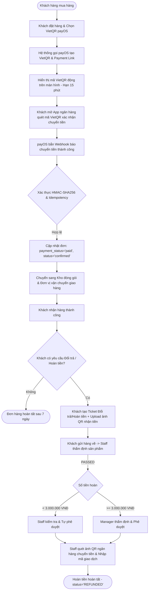

# TỔNG QUAN NGHIỆP VỤ THANH TOÁN (PAYMENT) & PHƯƠNG ÁN THỰC THI CHÍNH THỨC
> **Dự án:** Badminton Shop Management System (SBA301_BadmintonShop_SE1986-JV)  
> **Công nghệ:** Java 21, Spring Boot 3, React (Vite), SQL Server, payOS (VietQR Napas 24/7)  
> **Quyết định phạm vi (Scope Decision):**  
> 1. **BỎ HOÀN TOÀN COD (Cash On Delivery):** 100% đơn hàng online bắt buộc thanh toán trả trước qua cổng thanh toán payOS (VietQR) trước khi xuất kho.  
> 2. **BỎ PHƯƠNG ÁN 3 (Tự động hoàn tiền Payout API):** Không sử dụng Payout API do rào cản pháp nhân doanh nghiệp và rủi ro ví tiền thực tế.  
> 3. **PHƯƠNG ÁN CHÍNH THỨC:** Thanh toán 100% Online (payOS VietQR) kết hợp Hoàn tiền thủ công quét mã QR ngân hàng (Manual QR Transfer) theo phân quyền duyệt < 3M (Staff) và $\ge$ 3M (Manager).

---

## 1. BỐI CẢNH & HIỆN TRẠNG HỆ THỐNG

Hệ thống SBA301 Badminton Shop là nền tảng thương mại điện tử chuyên biệt cho sản phẩm cầu lông (vợt, giày, phụ kiện, đan cước) kết hợp quản lý kho, giao vận và hỗ trợ sau bán hàng (đổi trả, bảo hành).

### 1.1. Hiện trạng triển khai mã nguồn
1. **Frontend (React Vite):**
   - Đã xây dựng các trang thanh toán:
     - [`CheckoutPage.jsx`](file:///d:/_Ky7-FPTU/SBA301/gr_project/SBA301_BadmintonShop_SE1986-JV/frontend/src/modules/payment/pages/CheckoutPage.jsx): Chọn thanh toán (đã lược bỏ COD, chỉ giữ Chuyển khoản VietQR payOS).
     - [`QrPaymentPage.jsx`](file:///d:/_Ky7-FPTU/SBA301/gr_project/SBA301_BadmintonShop_SE1986-JV/frontend/src/modules/payment/pages/QrPaymentPage.jsx): Hiển thị mã VietQR động từ payOS, số tiền và nội dung chuyển khoản tự động.
     - [`PaymentResultPage.jsx`](file:///d:/_Ky7-FPTU/SBA301/gr_project/SBA301_BadmintonShop_SE1986-JV/frontend/src/modules/payment/pages/PaymentResultPage.jsx): Hiển thị kết quả thanh toán thành công/thất bại.
   - Có cơ chế **Polling kiểm tra trạng thái thanh toán** định kỳ mỗi 3 giây khi khách mở màn hình QR.
   - Các route thanh toán được bảo vệ bởi [`ProtectedRoute`](file:///d:/_Ky7-FPTU/SBA301/gr_project/SBA301_BadmintonShop_SE1986-JV/frontend/src/app/router/ProtectedRoute.jsx) yêu cầu người dùng phải đăng nhập tài khoản.
2. **Cơ sở dữ liệu (SQL Server - `badminton_shop.sql`):**
   - Bảng [`payments`](file:///d:/_Ky7-FPTU/SBA301/gr_project/SBA301_BadmintonShop_SE1986-JV/badminton_shop.sql#L394): Quản lý phiên thanh toán (`method = 'qr'`, `status`, `amount`, `gateway_txn_ref`, `qr_code_url`).
   - Bảng [`payment_transactions`](file:///d:/_Ky7-FPTU/SBA301/gr_project/SBA301_BadmintonShop_SE1986-JV/badminton_shop.sql#L412): Lưu vết toàn bộ log request, response, webhook callback (chuỗi JSON phục vụ đối soát, tra soát).
   - Bảng [`refunds`](file:///d:/_Ky7-FPTU/SBA301/gr_project/SBA301_BadmintonShop_SE1986-JV/badminton_shop.sql#L422): Lưu trữ các lệnh hoàn tiền gắn với ticket đổi trả (`ticket_id`).
   - Bảng [`shipments`](file:///d:/_Ky7-FPTU/SBA301/gr_project/SBA301_BadmintonShop_SE1986-JV/badminton_shop.sql#L450): Do bỏ COD, trường `cod_amount` luôn bằng 0, không phát sinh nghiệp vụ thu hộ tiền mặt.
3. **Backend (Spring Boot):**
   - Phân hệ hỗ trợ sau bán hàng đã có các controller phân quyền theo role: [`CustomerTicketController`](file:///d:/_Ky7-FPTU/SBA301/gr_project/SBA301_BadmintonShop_SE1986-JV/backend/badmintonshop/src/main/java/fu/se/badmintonshop/modules/support_ticket/controller/CustomerTicketController.java), [`StaffTicketController`](file:///d:/_Ky7-FPTU/SBA301/gr_project/SBA301_BadmintonShop_SE1986-JV/backend/badmintonshop/src/main/java/fu/se/badmintonshop/modules/support_ticket/controller/StaffTicketController.java), [`ManagerTicketController`](file:///d:/_Ky7-FPTU/SBA301/gr_project/SBA301_BadmintonShop_SE1986-JV/backend/badmintonshop/src/main/java/fu/se/badmintonshop/modules/support_ticket/controller/ManagerTicketController.java).

---

## 2. TỔNG QUAN NGHIỆP VỤ THANH TOÁN SAU KHI LOẠI BỎ COD

Với quyết định **bỏ hoàn toàn COD** và **bỏ Payout API tự động**, hệ thống tập trung vào 2 luồng nghiệp vụ cốt lõi, rõ ràng và mạch lạc:



### 2.1. Nghiệp vụ 1: Thanh toán trực tuyến 100% qua payOS (VietQR Napas 24/7)
- **Nguyên tắc cốt lõi:** Đơn hàng chỉ được xác nhận (`status = 'confirmed'`) và xuất kho khi tiền đã thực sự về tài khoản cửa hàng (`payment_status = 'paid'`).
- **Quy trình chi tiết:**
  1. **Tạo phiên thanh toán:** Khi khách bấm "Đặt hàng", Backend gọi API v2 của cổng payOS (`/v2/payment-requests`), tạo mã VietQR kèm link thanh toán. Phiên có hạn 15 phút (`expires_at = now + 15m`).
  2. **Trải nghiệm khách hàng:** 
     - Khách hàng không cần nhập bất kỳ thông tin nào (số tài khoản, tên ngân hàng, nội dung).
     - Màn hình hiển thị mã VietQR động chuẩn Napas 24/7. Khách mở ứng dụng ngân hàng bất kỳ (Vietcombank, Techcombank, MBBank, BIDV...) quét mã và ấn xác nhận chuyển tiền.
  3. **Xử lý Webhook tức thì:**
     - Ngay khi tiền vào tài khoản, payOS bắn tín hiệu **Webhook** sang Backend hệ thống.
     - Backend xác thực chữ ký bảo mật **HMAC-SHA256** với `checksumKey` của payOS.
     - Backend kiểm tra tính bất biến **Idempotency** (chống xử lý trùng lặp giao dịch).
     - Cập nhật đồng bộ: `payments.status = 'paid'` và `orders.payment_status = 'paid'`, `orders.status = 'confirmed'`.
  4. **Cập nhật giao diện:** Frontend nhận trạng thái `paid` qua Polling (3s/lần) lập tức chuyển sang màn hình thông báo thanh toán thành công và chuyển đơn vào danh sách đang chuẩn bị đóng gói.
  5. **Quản lý hết hạn (Timeout):** Nếu sau 15 phút khách không quét mã chuyển khoản, hệ thống chuyển giao dịch sang `expired`, tự động hủy đơn và nhả số lượng tồn kho sản phẩm cho khách khác.

### 2.2. Nghiệp vụ 2: Hoàn tiền đổi trả (Refunds - UC15 & UC13)
- **Nguyên tắc cốt lõi:** Bán tự động (Manual QR Transfer). Không gọi API tự động trừ ví, loại bỏ rủi ro mất tiền ngoài ý muốn.
- **Quy trình chi tiết:**
  1. **Khách hàng tạo yêu cầu:** Khách hàng vào mục Đổi trả/Hoàn tiền, chọn đơn hàng (trong vòng 7 ngày kể từ khi nhận hàng), nêu lý do và **bắt buộc upload ảnh mã QR tài khoản ngân hàng** nhận tiền.
  2. **Thẩm định hàng trả về:** Khách gửi sản phẩm cũ về shop. Nhân viên kho/CSKH kiểm tra tình trạng hàng:
     - Nếu `FAILED`: Từ chối hoàn tiền, gửi trả sản phẩm cũ cho khách.
     - Nếu `PASSED`: Hệ thống tính toán chính xác số tiền hoàn (gồm tiền hàng đã trả, cộng thêm tiền ship nếu lỗi thuộc về cửa hàng `STORE_FAULT`).
  3. **Phân quyền xét duyệt 2 cấp độ (Role Authorization Threshold):**
     - **Khoản hoàn < 3.000.000 VNĐ:** Nhân viên CSKH (`STAFF`) có thẩm quyền trực tiếp ấn duyệt (`approveRefund`), trạng thái chuyển sang `PENDING_TRANSFER`.
     - **Khoản hoàn $\ge$ 3.000.000 VNĐ:** Nhân viên **không có quyền duyệt**. Ticket chuyển sang trạng thái `PENDING_APPROVAL`. Chỉ Quản lý (`MANAGER`) mới có quyền phê duyệt hoặc từ chối (`managerDecision`).
  4. **Thực hiện chuyển khoản:**
     - Nhân viên phụ trách mở ứng dụng ngân hàng, quét trực tiếp ảnh mã QR do khách hàng upload.
     - Thực hiện chuyển đúng số tiền đã duyệt.
     - Nhập mã giao dịch ngân hàng (Bank Transaction Reference, ví dụ: `FT2611018899`) và ghi chú vào hệ thống.
     - Hệ thống cập nhật `payments.status = 'refunded'`, `orders.payment_status = 'refunded'`, ticket chuyển sang `REFUNDED`.

---

## 3. PHÂN TÍCH LÝ DO VÀ LỢI ÍCH CỦA VIỆC LOẠI BỎ HOÀN TOÀN COD

Việc loại bỏ hoàn toàn phương thức COD (Thu tiền khi nhận hàng) và chọn mô hình **100% Trả trước qua payOS VietQR** mang lại các giá trị vượt trội:

| Khía cạnh | Khi còn COD | Khi loại bỏ hoàn toàn COD (100% Online VietQR) |
| :--- | :--- | :--- |
| **Rủi ro bùng hàng (bom hàng)** | Khách đặt chơi, không nhận hàng khi shipper gọi. Shop mất phí vận chuyển 2 chiều và bị giam hàng trong kho shipper. | **Triệt tiêu 100% rủi ro bom hàng.** Khách đã trả tiền 100% mới đóng gói xuất kho. |
| **Quy trình đóng gói & xuất kho** | Nhân viên kho phải kiểm tra xem đơn đã trả tiền chưa hay là COD; nhầm lẫn sẽ gây thất thoát tiền. | Đơn vào trạng thái `confirmed` là chắc chắn đã thu đủ tiền 100%. Kho chỉ việc xuất hàng đóng gói. |
| **Hệ thống giao vận (FastShip)** | Phải quản lý trường `cod_amount`, theo dõi tài xế đã nộp tiền mặt về chưa, quản lý trạng thái `cod_collected_at`. | Module giao vận cực kỳ tinh gọn: Shipper chỉ làm đúng nhiệm vụ giao hàng, không giữ tiền mặt, không lo thất thoát. |
| **Đối soát & Kế toán dòng tiền** | Cần đối soát công nợ định kỳ phức tạp giữa tài khoản shop và tiền mặt thu hộ của shipper. | Tiền vào thẳng tài khoản ngân hàng của shop tức thì qua VietQR Napas 24/7. |
| **Tính đồng nhất với phân hệ Đổi trả (UC15)** | Phát sinh xung đột logic: Đơn đã giao nhưng shipper chưa nộp tiền COD thì có được hoàn tiền không? | **Đồng nhất 100%:** Mọi đơn hàng khi khách yêu cầu đổi trả đều đã ở trạng thái `paid`. |

---

## 4. BẢNG TRẠNG THÁI VÀ ĐỒNG BỘ DỮ LIỆU ĐÃ LƯỢC BỎ COD

Khi loại bỏ COD, vòng đời đơn hàng và thanh toán trở nên vô cùng rõ ràng và chuẩn xác:

### 4.1. Bảng trạng thái hợp nhất
| Trạng thái `payments.status` | Trạng thái `orders.payment_status` | Trạng thái `orders.status` | Ý nghĩa nghiệp vụ |
| :--- | :--- | :--- | :--- |
| `pending` | `unpaid` | `pending` | Đơn hàng vừa tạo, đang chờ khách quét VietQR trong 15 phút |
| `paid` | `paid` | `confirmed` | payOS bắn webhook xác nhận tiền đã vào tài khoản. Đơn sẵn sàng đóng gói |
| `expired` | `unpaid` | `cancelled` | Quá 15 phút khách không chuyển tiền. Hệ thống tự hủy đơn và nhả số lượng tồn kho |
| `cancelled` | `unpaid` | `cancelled` | Khách chủ động hủy yêu cầu thanh toán |
| `failed` | `unpaid` | `pending` | Giao dịch qua cổng lỗi, khách có thể tạo lại mã QR |
| `refunded` | `refunded` | `returned` / `completed` | Đã hoàn tất chuyển khoản tiền trả lại cho khách sau khi duyệt ticket |

### 4.2. Ánh xạ cơ sở dữ liệu (`badminton_shop.sql`)
- Bảng `payments`:
  - `method`: Sử dụng giá trị `'qr'` (và `'cash'` nếu thanh toán tiền mặt tại quầy). Không còn sử dụng giá trị `'cod'`.
  - `gateway`: `'payos'`.
- Bảng `shipments`:
  - `cod_amount = 0` cho toàn bộ các vận đơn.
  - Bỏ sự phụ thuộc vào `cod_collected_at` (vận đơn chỉ quan tâm các trạng thái: `preparing` $\rightarrow$ `picked_up` $\rightarrow$ `in_transit` $\rightarrow$ `delivered`).

---

## 5. ĐẶC TẢ DANH MỤC API THANH TOÁN CHUẨN

Toàn bộ API được triển khai tại package `fu.se.badmintonshop.modules.payment`:

```http
### 1. Tạo phiên thanh toán VietQR (Online Checkout)
POST /api/v1/payments/create
Content-Type: application/json

{
  "orderId": 105,
  "amount": 2500000,
  "description": "Thanh toan don hang #105",
  "buyerName": "Nguyen Van A",
  "buyerEmail": "a.nguyen@example.com",
  "buyerPhone": "0912345678"
}

Response (200 OK):
{
  "success": true,
  "data": {
    "paymentId": 201,
    "paymentCode": "PAY-20261101-00201",
    "payosOrderCode": 987654321,
    "checkoutUrl": "https://pay.payos.vn/web/...",
    "qrCodeUrl": "https://img.vietqr.io/image/...",
    "expiresAt": "2026-11-01T14:30:00Z"
  }
}
```

```http
### 2. Polling tra cứu trạng thái thanh toán (Frontend gọi 3s/lần)
GET /api/v1/payments/201

Response (200 OK):
{
  "success": true,
  "data": {
    "id": 201,
    "orderId": 105,
    "status": "paid",          // "pending" | "paid" | "expired" | "cancelled"
    "gatewayTxnRef": "FT2611018899",
    "paidAt": "2026-11-01T14:18:25Z"
  }
}
```

```http
### 3. Nhận Webhook tự động từ payOS (Server-to-Server)
POST /api/v1/payments/payos/webhook
Content-Type: application/json

{
  "code": "00",
  "desc": "success",
  "data": {
    "orderCode": 987654321,
    "amount": 2500000,
    "description": "Thanh toan don hang #105",
    "accountNumber": "1903678910",
    "reference": "FT2611018899",
    "currency": "VND",
    "code": "00"
  },
  "signature": "a5d8b... (HMAC-SHA256 signature tính từ data và checksumKey)"
}

Xử lý:
1. Verify signature HMAC-SHA256. Nếu sai -> Trả về HTTP 400.
2. Kiểm tra nếu payments.status == 'paid' -> Trả về HTTP 200 (Idempotency).
3. Update payments.status = 'paid', orders.payment_status = 'paid', orders.status = 'confirmed'.
4. Trả về HTTP 200 {"success": true, "message": "Processed"}.
```

```http
### 4. Ghi nhận hoàn tiền thủ công sau khi duyệt ticket (Staff/Manager)
POST /api/staff/support-tickets/{ticketId}/refund-transfer
Headers: X-User-Id: 2 (Staff ID)
Content-Type: application/json

{
  "transactionReference": "FT2611019900",
  "note": "Da chuyen khoan hoan tien qua anh QR cua khach"
}

Response (200 OK):
{
  "success": true,
  "message": "Đã ghi nhận chuyển khoản hoàn tiền thành công"
}
```

---

## 6. LỘ TRÌNH THỰC HIỆN VÀ CẬP NHẬT CODEBASE

Để hệ thống vận hành đúng theo phương án đã thống nhất, nhóm thực hiện các bước sau:

1. **Frontend (`frontend/`):**
   - File [`CheckoutPage.jsx`](file:///d:/_Ky7-FPTU/SBA301/gr_project/SBA301_BadmintonShop_SE1986-JV/frontend/src/modules/payment/pages/CheckoutPage.jsx): Bỏ ô chọn phương thức "COD". Mặc định chọn "Chuyển khoản VietQR payOS".
   - File [`mock/server.mjs`](file:///d:/_Ky7-FPTU/SBA301/gr_project/SBA301_BadmintonShop_SE1986-JV/frontend/mock/server.mjs): Bỏ logic xử lý thanh toán `cod`, đảm bảo mọi đơn hàng khi tạo đều đi vào luồng thanh toán trả trước.
2. **Backend Spring Boot (`backend/`):**
   - Viết Service tích hợp payOS Client (tạo Payment Link và tính mã HMAC-SHA256).
   - Viết Webhook Controller tiếp nhận thông báo từ payOS và cập nhật trạng thái đơn hàng.
   - Viết Task Scheduler / Cron job quét các đơn hàng `pending` quá 15 phút để tự động chuyển sang `expired` và nhả số lượng tồn kho sản phẩm.
3. **Phân hệ Đổi trả & Hoàn tiền (`support_ticket/`):**
   - Đảm bảo giữ vững phân quyền duyệt hoàn tiền: Ngưỡng < 3.000.000 VNĐ cho `STAFF` và $\ge$ 3.000.000 VNĐ cho `MANAGER` như đã thiết kế tại [`StaffTicketController.java`](file:///d:/_Ky7-FPTU/SBA301/gr_project/SBA301_BadmintonShop_SE1986-JV/backend/badmintonshop/src/main/java/fu/se/badmintonshop/modules/support_ticket/controller/StaffTicketController.java) và [`ManagerTicketController.java`](file:///d:/_Ky7-FPTU/SBA301/gr_project/SBA301_BadmintonShop_SE1986-JV/backend/badmintonshop/src/main/java/fu/se/badmintonshop/modules/support_ticket/controller/ManagerTicketController.java).
