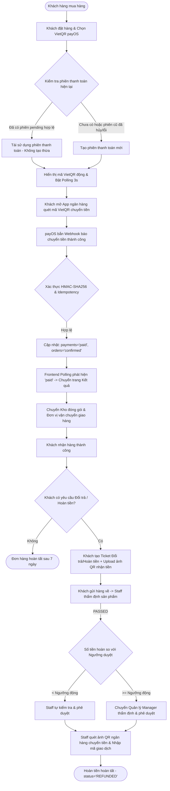

# TỔNG QUAN NGHIỆP VỤ THANH TOÁN (PAYMENT) & PHƯƠNG ÁN THỰC THI CHÍNH THỨC
> **Dự án:** Badminton Shop Management System (SBA301_BadmintonShop_SE1986-JV)  
> **Công nghệ:** Java 21, Spring Boot 3, React 19 (Vite), SQL Server, payOS (VietQR Napas 24/7)  
> **Quyết định phạm vi & Cải tiến hệ thống (Scope & System Updates):**  
> 1. **BỎ HOÀN TOÀN COD (Cash On Delivery):** 100% đơn hàng online bắt buộc thanh toán trả trước qua cổng thanh toán payOS (VietQR) trước khi xuất kho giao hàng.  
> 2. **BỎ PHƯƠNG ÁN 3 (Tự động hoàn tiền Payout API):** Không sử dụng Payout API do rào cản tài khoản doanh nghiệp và rủi ro ví tiền thực tế.  
> 3. **PHƯƠNG ÁN CHÍNH THỨC:** Thanh toán 100% Online (payOS VietQR) kết hợp Hoàn tiền thủ công quét mã QR ngân hàng (Manual QR Transfer) theo phân quyền duyệt linh hoạt.  
> 4. **CẤU HÌNH NGƯỠNG DUYỆT ĐỘNG (Dynamic Threshold):** Thay vì cố định 3.000.000 VNĐ, Quản lý (`MANAGER`) có thể tùy chỉnh ngưỡng duyệt hoàn tiền trực tiếp qua API và giao diện quản trị (lưu trữ trong bảng `system_settings`).  
> 5. **TỰ ĐỘNG POLLING (Auto-Polling 3s):** Frontend tự động quét trạng thái thanh toán mỗi 3 giây và tự động chuyển trang ngay khi giao dịch thành công.  
> 6. **TỐI ƯU HÓA PHIÊN THANH TOÁN (Session Reuse):** Khắc phục triệt để lỗi tạo thừa bản ghi thanh toán khi checkout bằng cơ chế tái sử dụng (reuse) bản ghi `pending` đang hoạt động.  
> 7. **TỰ ĐỘNG NẠP BIẾN MÔI TRƯỜNG (.env Auto-loader):** Backend tự động nạp cấu hình `PAYOS_*` từ file `.env` khi khởi động ứng dụng.  
> 8. **HOÀN TOÀN KHÔNG DÙNG MOCK SERVER:** 100% luồng chạy trên Backend Spring Boot thực và cơ sở dữ liệu SQL Server.

---

## 1. BỐI CẢNH & HIỆN TRẠNG HỆ THỐNG

Hệ thống SBA301 Badminton Shop là nền tảng thương mại điện tử chuyên biệt cho sản phẩm cầu lông (vợt, giày, phụ kiện, đan cước) kết hợp quản lý kho, giao vận và hỗ trợ sau bán hàng (đổi trả, bảo hành).

### 1.1. Hiện trạng triển khai mã nguồn
1. **Frontend (React 19 Vite):**
   - Các trang thanh toán và quản trị đã hoàn thiện:
     - [`CheckoutPage.jsx`](file:///d:/_Ky7-FPTU/SBA301/gr_project/SBA301_BadmintonShop_SE1986-JV/frontend/src/modules/payment/pages/CheckoutPage.jsx): Chọn phương thức thanh toán trả trước (đã loại bỏ COD, mặc định VietQR payOS).
     - [`QrPaymentPage.jsx`](file:///d:/_Ky7-FPTU/SBA301/gr_project/SBA301_BadmintonShop_SE1986-JV/frontend/src/modules/payment/pages/QrPaymentPage.jsx): Hiển thị mã VietQR động từ payOS, số tiền và nội dung chuyển khoản tự động kèm đồng hồ đếm ngược và trạng thái kiểm tra tự động.
     - [`PaymentResultPage.jsx`](file:///d:/_Ky7-FPTU/SBA301/gr_project/SBA301_BadmintonShop_SE1986-JV/frontend/src/modules/payment/pages/PaymentResultPage.jsx): Hiển thị kết quả thanh toán thành công hoặc thất bại/hủy.
     - [`SupportTicketManagementPage.jsx`](file:///d:/_Ky7-FPTU/SBA301/gr_project/SBA301_BadmintonShop_SE1986-JV/frontend/src/modules/support/pages/SupportTicketManagementPage.jsx): Màn hình quản lý ticket hỗ trợ, tích hợp Badge hiển thị ngưỡng duyệt và Modal cho phép Manager điều chỉnh ngưỡng linh hoạt.
     - [`SupportTicketManagementDetailPage.jsx`](file:///d:/_Ky7-FPTU/SBA301/gr_project/SBA301_BadmintonShop_SE1986-JV/frontend/src/modules/support/pages/SupportTicketManagementDetailPage.jsx): Màn hình chi tiết xử lý duyệt hoàn tiền theo ngưỡng động.
   - Cơ chế **Polling tự động 3 giây** được tích hợp qua hook [`usePayment.js`](file:///d:/_Ky7-FPTU/SBA301/gr_project/SBA301_BadmintonShop_SE1986-JV/frontend/src/modules/payment/hooks/usePayment.js), tự động dọn dẹp interval và tự động điều hướng khách hàng khi tiền về tài khoản.
   - Các route thanh toán được bảo vệ bởi [`ProtectedRoute`](file:///d:/_Ky7-FPTU/SBA301/gr_project/SBA301_BadmintonShop_SE1986-JV/frontend/src/app/router/ProtectedRoute.jsx).
2. **Cơ sở dữ liệu (SQL Server - `badmintonshop.sql`):**
   - Bảng [`payments`](file:///d:/_Ky7-FPTU/SBA301/gr_project/SBA301_BadmintonShop_SE1986-JV/badmintonshop.sql): Quản lý phiên thanh toán (`method = 'qr'`, `gateway = 'payos'`, `status`, `amount`, `gateway_txn_ref`, `qr_code_url`, `checkout_url`).
   - Bảng [`payment_transactions`](file:///d:/_Ky7-FPTU/SBA301/gr_project/SBA301_BadmintonShop_SE1986-JV/badmintonshop.sql): Lưu vết toàn bộ request tạo link và callback webhook (chuỗi JSON đối soát).
   - Bảng [`refunds`](file:///d:/_Ky7-FPTU/SBA301/gr_project/SBA301_BadmintonShop_SE1986-JV/badmintonshop.sql): Lưu trữ lệnh hoàn tiền gắn với ticket đổi trả (`ticket_id`).
   - Bảng [`system_settings`](file:///d:/_Ky7-FPTU/SBA301/gr_project/SBA301_BadmintonShop_SE1986-JV/badmintonshop.sql): Lưu cấu hình hệ thống bao gồm `refund_approval_threshold` (mặc định 3.000.000 VNĐ).
   - Bảng [`shipments`](file:///d:/_Ky7-FPTU/SBA301/gr_project/SBA301_BadmintonShop_SE1986-JV/badmintonshop.sql): `cod_amount = 0`, không phát sinh thu hộ tiền mặt.
3. **Backend (Spring Boot 3 - Java 21):**
   - Package [`modules.payment`](file:///d:/_Ky7-FPTU/SBA301/gr_project/SBA301_BadmintonShop_SE1986-JV/backend/badmintonshop/src/main/java/fu/se/badmintonshop/modules/payment/): Controller, Service, Scheduler kiểm tra timeout, Webhook xử lý HMAC-SHA256 và Idempotency.
   - Tái sử dụng phiên thanh toán (Session Reuse): [`PaymentServiceImpl.java`](file:///d:/_Ky7-FPTU/SBA301/gr_project/SBA301_BadmintonShop_SE1986-JV/backend/badmintonshop/src/main/java/fu/se/badmintonshop/modules/payment/service/impl/PaymentServiceImpl.java) kiểm tra bản ghi `pending` hiện có của đơn hàng để tránh chèn thừa bản ghi mới.
   - Nạp cấu hình tự động: [`BadmintonshopApplication.java`](file:///d:/_Ky7-FPTU/SBA301/gr_project/SBA301_BadmintonShop_SE1986-JV/backend/badmintonshop/src/main/java/fu/se/badmintonshop/BadmintonshopApplication.java) tự động đọc file `.env` vào System Properties.
   - Quản lý ngưỡng động: [`ManagerTicketController.java`](file:///d:/_Ky7-FPTU/SBA301/gr_project/SBA301_BadmintonShop_SE1986-JV/backend/badmintonshop/src/main/java/fu/se/badmintonshop/modules/supportticket/controller/ManagerTicketController.java) cung cấp API `GET`/`PUT /api/manager/support-tickets/settings/threshold`.

---

## 2. QUY TRÌNH NGHIỆP VỤ THANH TOÁN VÀ HOÀN TIỀN



### 2.1. Nghiệp vụ 1: Thanh toán trực tuyến 100% qua payOS (VietQR Napas 24/7)
- **Nguyên tắc cốt lõi:** Đơn hàng chỉ được xác nhận (`status = 'confirmed'`) và xuất kho khi tiền đã thực sự về tài khoản cửa hàng (`payment_status = 'paid'`).
- **Quy trình chi tiết:**
  1. **Tạo/Tái sử dụng phiên thanh toán:**
     - Khi khách bấm "Đặt hàng", hệ thống tạo đơn hàng và bản ghi `Payment` đầu tiên ở trạng thái `pending`.
     - Khi điều hướng sang trang QR, hệ thống gọi `POST /api/v1/payments/create`. Backend kiểm tra nếu đơn hàng đã có bản ghi `pending` còn hiệu lực (< 14 phút), hệ thống **tái sử dụng bản ghi này**, trả về link/QR hiện có mà không sinh thêm bản ghi dư thừa và không gọi lặp lại sang payOS gây lỗi duplicate code.
  2. **Trải nghiệm khách hàng:** 
     - Khách hàng không cần nhập bất kỳ thông tin nào (số tài khoản, tên ngân hàng, nội dung).
     - Màn hình hiển thị mã VietQR động chuẩn Napas 24/7. Khách mở ứng dụng ngân hàng bất kỳ (Vietcombank, Techcombank, MBBank, BIDV...) quét mã và ấn xác nhận chuyển tiền.
  3. **Xử lý Webhook tức thì:**
     - Ngay khi tiền vào tài khoản, payOS bắn tín hiệu **Webhook** sang Backend hệ thống.
     - Backend xác thực chữ ký bảo mật **HMAC-SHA256** với `checksumKey` của payOS.
     - Backend kiểm tra tính bất biến **Idempotency** (chống xử lý trùng lặp giao dịch).
     - Cập nhật đồng bộ: `payments.status = 'paid'` và `orders.payment_status = 'paid'`, `orders.status = 'confirmed'`.
  4. **Cập nhật giao diện tự động (Auto-Polling):**
     - Frontend kích hoạt Polling ngầm mỗi 3 giây qua `usePayment.js`.
     - Ngay khi phát hiện đơn hàng chuyển sang `paid`, hook tự động dừng interval và điều hướng người dùng tới `/payments/result?order={id}` với thông báo thanh toán thành công.
  5. **Quản lý hết hạn (Timeout Scheduler):**
     - Scheduler định kỳ quét mỗi 60 giây. Nếu sau 15 phút khách không quét mã chuyển khoản, hệ thống chuyển giao dịch sang `expired`, tự động hủy đơn và nhả số lượng tồn kho sản phẩm cho khách khác.

### 2.2. Nghiệp vụ 2: Hoàn tiền đổi trả (Refunds - UC15 & UC13)
- **Nguyên tắc cốt lõi:** Bán tự động (Manual QR Transfer). Không gọi API tự động trừ ví, loại bỏ rủi ro mất tiền ngoài ý muốn.
- **Quy trình chi tiết:**
  1. **Khách hàng tạo yêu cầu:** Khách hàng vào mục Đổi trả/Hoàn tiền, chọn đơn hàng (trong vòng 7 ngày kể từ khi nhận hàng), nêu lý do và **bắt buộc upload ảnh mã QR tài khoản ngân hàng** nhận tiền.
  2. **Thẩm định hàng trả về:** Khách gửi sản phẩm cũ về shop. Nhân viên kho/CSKH kiểm tra tình trạng hàng:
     - Nếu `FAILED`: Từ chối hoàn tiền, gửi trả sản phẩm cũ cho khách.
     - Nếu `PASSED`: Hệ thống tính toán chính xác số tiền hoàn (gồm tiền hàng đã trả, cộng thêm tiền ship nếu lỗi thuộc về cửa hàng `STORE_FAULT`).
  3. **Phân quyền xét duyệt 2 cấp độ theo Ngưỡng động (Dynamic Approval Threshold):**
     - Ngưỡng được đọc trực tiếp từ bảng `system_settings` (mặc định 3.000.000 VNĐ). Quản lý (`MANAGER`) có thể điều chỉnh bất kỳ lúc nào qua nút "Thiết lập ngưỡng duyệt" trên giao diện quản trị.
     - **Khoản hoàn < Ngưỡng duyệt:** Nhân viên CSKH (`STAFF`) có thẩm quyền trực tiếp ấn duyệt (`approveRefund`), trạng thái chuyển sang `PENDING_TRANSFER`.
     - **Khoản hoàn $\ge$ Ngưỡng duyệt:** Nhân viên **không có quyền duyệt**. Ticket chuyển sang trạng thái `PENDING_APPROVAL`. Chỉ Quản lý (`MANAGER`) mới có quyền phê duyệt hoặc từ chối (`managerDecision`).
  4. **Thực hiện chuyển khoản:**
     - Nhân viên phụ trách mở ứng dụng ngân hàng, quét trực tiếp ảnh mã QR do khách hàng upload.
     - Thực hiện chuyển đúng số tiền đã duyệt.
     - Nhập mã giao dịch ngân hàng (Bank Transaction Reference, ví dụ: `FT2611078899`) và ghi chú vào hệ thống.
     - Hệ thống cập nhật `payments.status = 'refunded'`, `orders.payment_status = 'refunded'`, ticket chuyển sang `REFUNDED`.

---

## 3. PHÂN TÍCH LÝ DO VÀ LỢI ÍCH CỦA VIỆC LOẠI BỎ HOÀN TOÀN COD

Việc loại bỏ hoàn toàn phương thức COD (Thu tiền khi nhận hàng) và chọn mô hình **100% Trả trước qua payOS VietQR** mang lại các giá trị vượt trội:

| Khía cạnh | Khi còn COD | Khi loại bỏ hoàn toàn COD (100% Online VietQR) |
| :--- | :--- | :--- |
| **Rủi ro bùng hàng (bom hàng)** | Khách đặt chơi, không nhận hàng khi shipper gọi. Shop mất phí vận chuyển 2 chiều và bị giam hàng trong kho shipper. | **Triệt tiêu 100% rủi ro bom hàng.** Khách đã trả tiền 100% mới đóng gói xuất kho. |
| **Quy trình đóng gói & xuất kho** | Nhân viên kho phải kiểm tra xem đơn đã trả tiền chưa hay là COD; nhầm lẫn sẽ gây thất thoát tiền. | Đơn vào trạng thái `confirmed` là chắc chắn đã thu đủ tiền 100%. Kho chỉ việc xuất hàng đóng gói. |
| **Hệ thống giao vận (FastShip)** | Phải quản lý trường `cod_amount`, theo dõi tài xế đã nộp tiền mặt về chưa, quản lý trạng thái `cod_collected_at`. | Module giao vận cực kỳ tinh gọn: Shipper chỉ làm đúng nhiệm vụ giao hàng, không giữ tiền mặt, không lo thất thoát. |
| **Đối soát & Kế toán dòng tiền** | Cần đối soát công nợ định kỳ phức tạp giữa tài khoản shop và tiền mặt thu hộ của shipper. | Tiền vào thẳng tài khoản ngân hàng của shop tức thì qua VietQR Napas 24/7. |
| **Tính đồng nhất với phân hệ Đổi trả (UC15)** | Phát sinh xung đột logic: Đơn đã giao nhưng shipper chưa nộp tiền COD thì có được hoàn tiền không? | **Đồng nhất 100%:** Mọi đơn hàng khi khách yêu cầu đổi trả đều đã ở trạng thái `paid`. |

---

## 4. BẢNG TRẠNG THÁI VÀ ĐỒNG BỘ DỮ LIỆU ĐÃ LƯỢC BỎ COD

Khi loại bỏ COD, vòng đời đơn hàng và thanh toán trở nên vô cùng rõ ràng và chuẩn xác:

### 4.1. Bảng trạng thái hợp nhất
| Trạng thái `payments.status` | Trạng thái `orders.payment_status` | Trạng thái `orders.status` | Ý nghĩa nghiệp vụ |
| :--- | :--- | :--- | :--- |
| `pending` | `unpaid` | `pending` | Đơn hàng vừa tạo, đang chờ khách quét VietQR trong 15 phút |
| `paid` | `paid` | `confirmed` | payOS bắn webhook xác nhận tiền đã vào tài khoản. Đơn sẵn sàng đóng gói |
| `expired` | `unpaid` | `cancelled` | Quá 15 phút khách không chuyển tiền. Hệ thống tự hủy đơn và nhả số lượng tồn kho |
| `cancelled` | `unpaid` | `cancelled` | Khách chủ động hủy yêu cầu thanh toán |
| `failed` | `unpaid` | `pending` | Giao dịch qua cổng lỗi, khách có thể tạo lại mã QR |
| `refunded` | `refunded` | `returned` / `completed` | Đã hoàn tất chuyển khoản tiền trả lại cho khách sau khi duyệt ticket |

### 4.2. Ánh xạ cơ sở dữ liệu (`badmintonshop.sql`)
- Bảng `payments`:
  - `method`: Sử dụng giá trị `'qr'`. Không còn sử dụng giá trị `'cod'`.
  - `gateway`: `'payos'`.
- Bảng `shipments`:
  - `cod_amount = 0` cho toàn bộ các vận đơn.
  - Bỏ sự phụ thuộc vào `cod_collected_at` (vận đơn chỉ quan tâm các trạng thái: `preparing` $\rightarrow$ `picked_up` $\rightarrow$ `in_transit` $\rightarrow$ `delivered`).
- Bảng `system_settings`:
  - Quản lý khóa `refund_approval_threshold` với kiểu dữ liệu `VARCHAR(255)`, lưu giá trị số thực dạng chuỗi (ví dụ: `3000000.00`).

---

## 5. ĐẶC TẢ DANH MỤC API THANH TOÁN VÀ QUẢN TRỊ

Toàn bộ API được triển khai tại package `fu.se.badmintonshop.modules.payment` và `fu.se.badmintonshop.modules.supportticket`:

```http
### 1. Tạo hoặc Tái sử dụng phiên thanh toán VietQR (Online Checkout)
POST /api/v1/payments/create
Content-Type: application/json

{
  "orderId": 105,
  "amount": 2500000,
  "description": "Thanh toan don hang #105",
  "buyerName": "Nguyen Van A",
  "buyerEmail": "a.nguyen@example.com",
  "buyerPhone": "0912345678"
}

Response (200 OK):
{
  "success": true,
  "data": {
    "paymentId": 201,
    "paymentCode": "PAY-20261107-00201",
    "payosOrderCode": 100201,
    "checkoutUrl": "https://pay.payos.vn/web/...",
    "qrCodeUrl": "https://img.vietqr.io/image/...",
    "expiresAt": "2026-11-07T14:30:00Z"
  }
}
*Lưu ý: Nếu orderId 105 đã có payment pending còn hạn, trả về dữ liệu payment hiện có (Session Reuse).*
```

```http
### 2. Polling tra cứu trạng thái thanh toán (Frontend gọi 3s/lần)
GET /api/v1/payments/201

Response (200 OK):
{
  "success": true,
  "data": {
    "id": 201,
    "orderId": 105,
    "status": "paid",          // "pending" | "paid" | "expired" | "cancelled" | "failed"
    "gatewayTxnRef": "FT2611078899",
    "paidAt": "2026-11-07T14:18:25Z"
  }
}
```

```http
### 3. Nhận Webhook tự động từ payOS (Server-to-Server)
POST /api/v1/payments/payos/webhook
Content-Type: application/json

{
  "code": "00",
  "desc": "success",
  "data": {
    "orderCode": 100201,
    "amount": 2500000,
    "description": "Thanh toan don hang #105",
    "accountNumber": "1903678910",
    "reference": "FT2611078899",
    "currency": "VND",
    "code": "00"
  },
  "signature": "a5d8b... (HMAC-SHA256 signature)"
}

Xử lý:
1. Verify signature HMAC-SHA256. Nếu sai -> Trả về HTTP 400.
2. Kiểm tra nếu payments.status == 'paid' -> Trả về HTTP 200 (Idempotency).
3. Update payments.status = 'paid', orders.payment_status = 'paid', orders.status = 'confirmed'.
4. Trả về HTTP 200 {"success": true, "code": "00", "message": "Processed"}.
```

```http
### 4. Quản lý xem và cập nhật ngưỡng duyệt hoàn tiền động (Manager)
# Xem ngưỡng hiện tại
GET /api/manager/support-tickets/settings/threshold

Response (200 OK):
{
  "success": true,
  "data": {
    "threshold": 3000000.00
  }
}

# Cập nhật ngưỡng mới
PUT /api/manager/support-tickets/settings/threshold
Content-Type: application/json

{
  "threshold": 5000000
}

Response (200 OK):
{
  "success": true,
  "data": {
    "threshold": 5000000.00
  },
  "message": "Cập nhật ngưỡng phê duyệt hoàn tiền thành công"
}
```

```http
### 5. Ghi nhận hoàn tiền thủ công sau khi duyệt ticket (Staff)
POST /api/staff/support-tickets/{ticketId}/refund-transfer
Headers: X-User-Id: 2 (Staff ID)
Content-Type: application/json

{
  "transactionReference": "FT2611079900",
  "note": "Da chuyen khoan hoan tien qua anh QR cua khach"
}

Response (200 OK):
{
  "success": true,
  "message": "Đã ghi nhận chuyển khoản hoàn tiền thành công"
}
```

---

## 6. HIỆN TRẠNG TRIỂN KHAI VÀ KẾT QUẢ NGHIỆM THU

Toàn bộ các hạng mục cốt lõi đã được xây dựng, cấu hình và nghiệm thu thực tế:

| Hạng mục | Trạng thái | Chi tiết triển khai & Nghiệm thu |
| :--- | :---: | :--- |
| **Loại bỏ COD & Chuẩn hóa VietQR payOS** | Hoàn thành | Đã loại bỏ phương thức tiền mặt COD trên cả Frontend và Backend. 100% đơn online tạo thanh toán VietQR Napas 24/7. |
| **Tự động quét Polling 3s** | Hoàn thành | Frontend tự động kích hoạt polling 3s tại `QrPaymentPage` và `PaymentResultPage`, tự động dừng interval và chuyển hướng khi tiền vào tài khoản. |
| **Tái sử dụng phiên thanh toán (Session Reuse)** | Hoàn thành | `PaymentServiceImpl.createPayment` tái sử dụng bản ghi `pending` đang hoạt động, triệt tiêu lỗi tạo thừa bản ghi payment khi khách checkout. |
| **Cấu hình Ngưỡng duyệt động (Dynamic Threshold)** | Hoàn thành | Thêm bảng `system_settings`, API `GET`/`PUT /api/manager/support-tickets/settings/threshold`, Modal UI trên `SupportTicketManagementPage` cho Quản lý. |
| **Tự động nạp `.env` (Environment Loader)** | Hoàn thành | `BadmintonshopApplication.loadDotEnv()` tự động nạp cấu hình `PAYOS_*` từ `backend/badmintonshop/.env` lúc khởi động. |
| **Kiểm thử tự động Backend (JUnit/Mockito)** | Hoàn thành | Toàn bộ 12/12 unit tests trong module Payment đều **PASS** (100% green: `PaymentServiceImplTest`, `PaymentControllerTest`, `PayosWebhookTest`, v.v.). |
| **Kiểm thử biên dịch Frontend (Vite Build)** | Hoàn thành | `npm run build` thành công xuất sắc, chuyển đổi 569 modules trong 783ms, không có bất kỳ lỗi cú pháp hoặc cảnh báo nào. |
