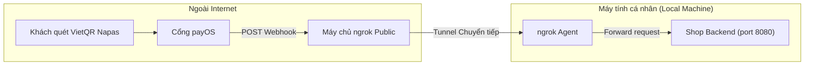

# BẢN CHẤT NGROK, WEBHOOK & CƠ CHẾ ĐỐI SOÁT THANH TOÁN (PAYOS)
> **Dự án:** Badminton Shop Management System (SBA301_BadmintonShop_SE1986-JV)  
> **Module:** Payment (Thanh toán trực tuyến payOS VietQR)  
> **Cập nhật:** Tháng 11/2026  

---

## 1. NGROK LÀ GÌ? VÌ SAO WEBHOOK CẦN NGROK KHI CHẠY LOCALHOST?

### 1.1. Bản chất của Webhook
* **Webhook** là cơ chế **Event-driven Push**: Khi có một sự kiện thanh toán thành công phát sinh tại ngân hàng, cổng thanh toán **payOS (nằm trên Internet)** sẽ chủ động gửi một HTTP POST request chứa dữ liệu giao dịch về máy chủ của Cửa hàng (**Shop Backend**).
* Để gửi được request này, payOS bắt buộc cần một **Public URL** (Địa chỉ IP tĩnh hoặc Tên miền công khai có thể truy cập được từ Internet).

### 1.2. Vấn đề của Localhost
* Khi lập trình trên máy tính cá nhân, Backend chạy tại `http://localhost:8080`.
* Địa chỉ `localhost` (hoặc `127.0.0.1`, IP mạng nội bộ `192.168.x.x`) nằm phía sau mạng riêng (Private Network) và tường lửa/NAT của Router nhà mạng. Máy chủ của payOS ngoài Internet **hoàn toàn không có cách nào gửi request trực tiếp về `localhost:8080` của bạn**.

### 1.3. Vai trò của ngrok
* **ngrok chính là công cụ sinh ra để giải quyết vấn đề trên cho Webhook:**
  * ngrok tạo ra một đường hầm bảo mật (**Secure Tunnel**) kết nối từ máy tính cá nhân của bạn tới máy chủ trung gian của ngrok ngoài Internet.
  * ngrok cấp cho bạn một Public URL tạm thời (Ví dụ: `https://abc-123.ngrok-free.app`).
  * Khi bạn đăng ký URL này với payOS (`https://abc-123.ngrok-free.app/api/payments/payos/webhook`), payOS sẽ bắn Webhook tới ngrok server, và ngrok sẽ chuyển tiếp (forward) request đó về đúng cổng `localhost:8080` trên máy của bạn.



---

## 2. HIỆN TRẠNG TẠI DỰ ÁN SBA301 BADMINTON SHOP

### 2.1. Ngrok hiện có đang chạy không?
* **KHÔNG.** Dự án không cài đặt ngrok chạy ngầm, file biến môi trường [`.env`](file:///backend/badmintonshop/.env) đã đóng (comment) biến `PAYOS_WEBHOOK_URL`.
* Khi dev và chạy thử ứng dụng trên localhost, lập trình viên **không cần bật ngrok**.

### 2.2. Vì sao không cần ngrok mà đơn hàng vẫn cập nhật thành công?
Dự án được thiết kế với **Cơ chế đối soát kép (Dual Verification)**:

```mermaid
flowchart TD
    User([Khách hàng quét VietQR Napas 24/7]) --> Paid[Tiền về tài khoản Cửa hàng tại payOS]

    subgraph Kênh 1: Webhook Push (Bị chặn trên Localhost nếu không có ngrok)
        Paid -.->|Bắn Webhook| PublicCheck{Có Public URL / ngrok?}
        PublicCheck -.->|Không có| Drop[payOS không gọi được localhost -> Bị bỏ qua]
        PublicCheck -->|Có ngrok / Production| WHAction[Backend nhận Webhook -> Xác thực HMAC-SHA256 -> Cập nhật 'paid']
    end

    subgraph Kênh 2: Active Polling Sync Pull (Cứu cánh trên Localhost - Đang chạy chính thức)
        Paid --> Ready[payOS lưu trạng thái giao dịch: PAID]
        Frontend[Frontend Polling 3s/lần hoặc bấm 'Kiểm tra kết quả'] -->|Gọi snapshot / sync API| Backend[Shop & Payment Service]
        Backend -->|GET /v2/payment-requests/orderCode| PayOSAPI[payOS API Tra cứu]
        PayOSAPI -->|Trả về status='PAID'| Backend
        Backend --> UpdateDB[Cập nhật đơn hàng: payment_status='paid', status='confirmed']
    end

    WHAction --> Finish([Đơn hàng sẵn sàng đóng gói & xuất kho])
    UpdateDB --> Finish
```

1. **Frontend Polling tự động 3 giây/lần:**
   * Tại [`usePayment.js`](file:///frontend/src/modules/payment/hooks/usePayment.js), một bộ đếm `setInterval` chạy mỗi 3 giây khi khách đang xem mã VietQR.
   * Khi lấy snapshot dữ liệu cửa hàng, [`ShopService.java`](file:///backend/badmintonshop/src/main/java/fu/se/badmintonshop/modules/shop/ShopService.java) gọi `payments.syncPendingPayments()`.
   * Backend chủ động gửi HTTP GET request sang API của payOS: `GET https://api-merchant.payos.vn/v2/payment-requests/{orderCode}`.
   * Ngay khi nhận được `status == "PAID"`, Backend tự động cập nhật đơn hàng thành `paid`.
2. **Nút kiểm tra chủ động:**
   * Tại [`QrPaymentPage.jsx`](file:///frontend/src/modules/payment/pages/QrPaymentPage.jsx), khách hàng có thể bấm *"Kiểm tra kết quả giao dịch"*, kích hoạt API `/api/payments/order/{orderId}/sync` để cập nhật trạng thái ngay lập tức.

---

## 3. SO SÁNH: WEBHOOK PUSH VÀ ACTIVE POLLING SYNC

| Tiêu chí | Kênh 1: Webhook Push | Kênh 2: Active Polling Sync (Đối soát) |
| :--- | :--- | :--- |
| **Bản chất** | **Thụ động (Push)**: payOS chủ động gửi tin báo sang Shop. | **Chủ động (Pull)**: Shop chủ động hỏi payOS xem đã có tiền chưa. |
| **Yêu cầu mạng** | Bắt buộc phải có **Public Domain** hoặc **ngrok** để payOS nhìn thấy. | **Không cần Public Domain hay ngrok**; chạy trực tiếp từ `localhost` ra ngoài Internet. |
| **Độ trễ** | Tức thì ngay khi ngân hàng xử lý xong (< 1 giây). | Phụ thuộc chu kỳ polling (từ 1 đến 3 giây). |
| **Tiêu hao tài nguyên** | Cực thấp (chỉ gửi 1 request khi có giao dịch). | Gửi request định kỳ 3 giây/lần trong tối đa 15 phút mở mã QR. |
| **Độ tin cậy** | Có thể bị rớt gói tin nếu mạng lag hoặc server shop tạm thời bận. | Rất cao, đóng vai trò **Fail-safe** bù đắp hoàn toàn khi Webhook bị rớt hoặc chậm trễ. |

---

## 4. CÓ THỂ BỎ NGROK VÀ CODE WEBHOOK ĐƯỢC KHÔNG?

### 4.1. Về công cụ ngrok
* 👉 **BỎ QUA, KHÔNG CẦN CHẠY.**
* Bạn không cần cài đặt hay chạy lệnh `ngrok` trong suốt quá trình phát triển, làm đồ án và demo trên máy cá nhân. Hệ thống tự đối soát qua API payOS cực kỳ ổn định và mượt mà.

### 4.2. Về Code Webhook trong Backend (`/api/payments/payos/webhook`)
* 👉 **TUYỆT ĐỐI KHÔNG NÊN BỎ / KHÔNG NÊN XÓA.**
* Lý do:
  1. **Yêu cầu chuẩn kiến trúc đồ án (SBA301 FPTU):**
     * Trong các đồ án thương mại điện tử tích hợp cổng thanh toán, **Webhook với chữ ký số HMAC-SHA256** là tiêu chuẩn kỹ thuật bắt buộc để chứng minh tính bảo mật và chuyên nghiệp của hệ thống.
     * Code trong [`PayOSServiceImpl.java`](file:///backend/badmintonshop/src/main/java/fu/se/badmintonshop/modules/payment/service/impl/PayOSServiceImpl.java) đã hiện thực thuật toán sắp xếp Canonical Alphabetic (A-Z) và băm HMAC-SHA256 chuẩn theo đặc tả của payOS. Xóa đi sẽ làm giảm chất lượng thiết kế kiến trúc.
  2. **Cơ chế chống trùng lặp (Idempotency):**
     * Hàm `markPaymentAsPaid()` trong [`PaymentServiceImpl.java`](file:///backend/badmintonshop/src/main/java/fu/se/badmintonshop/modules/payment/service/impl/PaymentServiceImpl.java) đã có cơ chế kiểm tra Idempotency: nếu đơn đã sang trạng thái `paid`, các request trùng lặp (dù từ Webhook hay từ Polling) sẽ tự động bị bỏ qua.
     * Do đó, hai kênh này **bổ trợ lẫn nhau hoàn hảo chứ không bao giờ gây xung đột hay cập nhật sai số tiền/trạng thái**.
  3. **Sẵn sàng triển khai Production / Cloud:**
     * Khi triển khai ứng dụng lên máy chủ thực tế (Cloud Server, VPS, Render, Railway...), bạn chỉ cần dán URL vào cổng quản trị payOS là hệ thống tự động kích hoạt tính năng Webhook real-time ngay lập tức mà không cần phải viết lại code.

---

## 5. HƯỚNG DẪN KIỂM THỬ WEBHOOK VỚI NGROK (NẾU CẦN DEMO TÍNH NĂNG WEBHOOK)

Trong trường hợp cần quay video hoặc demo trực tiếp với hội đồng phản biện về luồng nhận Webhook tự động:

1. **Khởi động ngrok trỏ về cổng backend (8080):**
   ```bash
   ngrok http 8080
   ```
2. **Lấy Forwarding URL:** Ví dụ `https://1234-abcd.ngrok-free.app`.
3. **Đăng ký Webhook URL với payOS:**
   * Cách 1: Vào trang quản trị payOS (`https://my.payos.vn/`) -> Chọn Kênh thanh toán -> Dán Webhook URL:  
     `https://1234-abcd.ngrok-free.app/api/payments/payos/webhook`.
   * Cách 2: Gọi API xác thực tích hợp sẵn của backend:
     ```http
     POST /api/payments/payos/confirm-webhook
     Content-Type: application/json
     
     {
       "webhookUrl": "https://1234-abcd.ngrok-free.app/api/payments/payos/webhook"
     }
     ```
4. **Kiểm tra Log:** Khi thanh toán đơn hàng, xem log của Backend sẽ thấy dòng:
   `Nhận Webhook từ payOS: code=00, desc=Success, orderCode=...`

