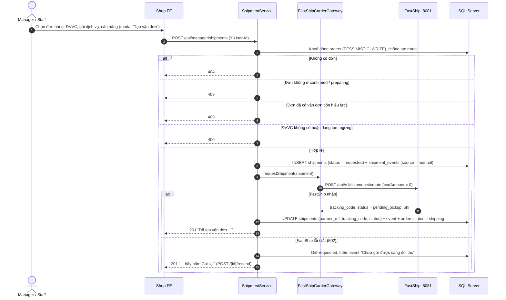
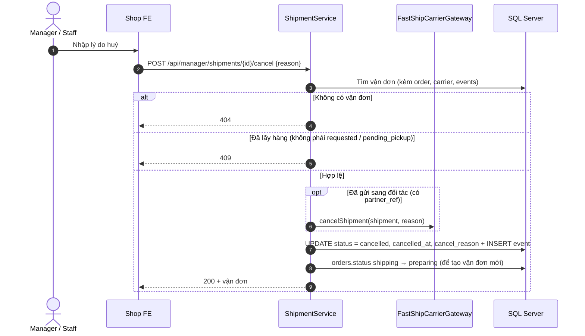
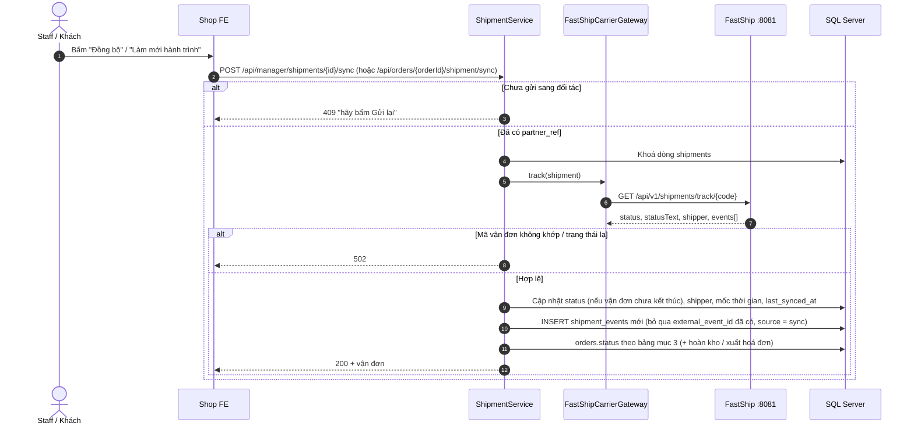
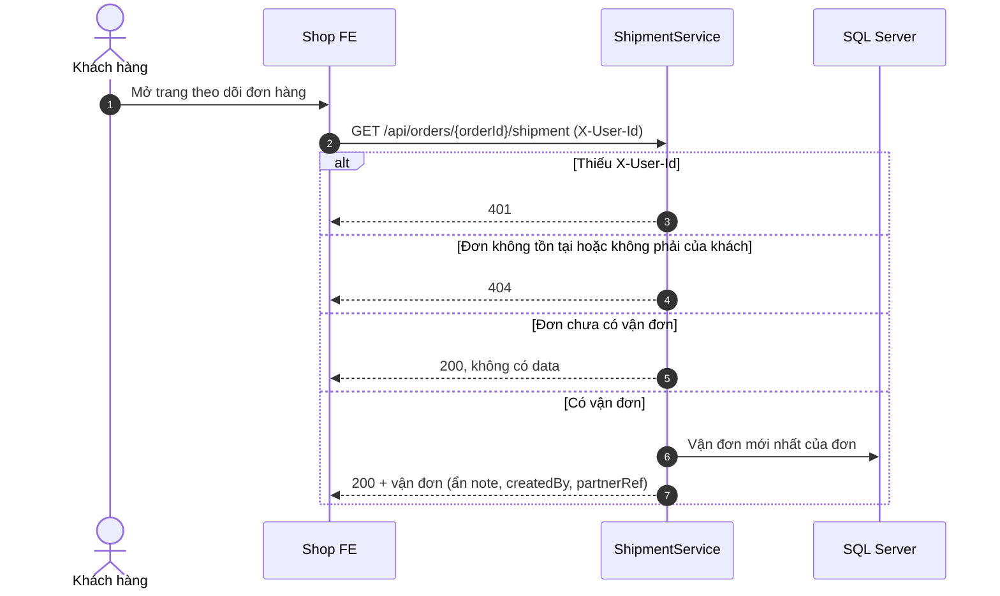

# LUỒNG HOẠT ĐỘNG MODULE SHIPPING & DELIVERY

> Trạng thái code: **giai đoạn 2** (FE nối BE, toàn bộ logic giao hàng nằm trong module delivery). Shop gọi FastShip qua API hiện tại của `partner-system` (`FastShipCarrierGateway`): đối tác cấp mã ngay khi nhận yêu cầu, trạng thái được đồng bộ bằng nút "Đồng bộ" (pull). Bước duyệt bên đối tác, webhook ký HMAC và job đồng bộ định kỳ thuộc giai đoạn 3–4.

## 1. Tổng quan

- Manager/Staff tạo vận đơn cho đơn hàng đã `confirmed` hoặc `preparing`, chọn đơn vị vận chuyển (hiện chỉ FastShip hoạt động).
- Shop không tự cấp mã vận đơn: vận đơn ở `requested` chờ đối tác duyệt (`pending_pickup`, có mã) hoặc từ chối (`rejected`).
- Mỗi đơn chỉ có **một vận đơn còn hiệu lực**. Vận đơn `cancelled` / `rejected` không tính, nên tạo lại được.
- Shop chỉ huỷ được khi bưu tá chưa lấy hàng (`requested`, `pending_pickup`).
- Khách xem vận đơn mới nhất của đơn hàng của mình.
- Không thu hộ (COD) trong phạm vi môn học: `cod_amount` luôn bằng 0 và không trả ra API.
- Backend delivery tự chuyển `orders.status` theo vận đơn (mục 3), tự hoàn kho khi chuyển hoàn và tự xuất hoá đơn khi đơn hoàn tất + đã thanh toán.

Thành phần chính (`backend/.../modules/delivery`):

| Lớp | Vai trò |
|---|---|
| `ManagerShipmentController` | `/api/manager/shipments`: danh sách, chi tiết, tạo, gửi lại, huỷ, đồng bộ |
| `CarrierController` | `/api/carriers`: ĐVVC đang hoạt động |
| `CustomerShipmentController` | `/api/orders/{orderId}/shipment`, `/sync`, `/api/my/shipments`: khách xem / làm mới vận đơn |
| `ShipmentService` | Nghiệp vụ vận đơn; `ShipmentSpecifications` lọc danh sách |
| `OrderFulfillmentService` | Chuyển `orders.status`, ghi `order_status_history`, hoàn kho, xuất hoá đơn |
| `CarrierGateway` / `FastShipCarrierGateway` | Gọi FastShip: tạo, huỷ, tra cứu (`CarrierTracking`). Lỗi gọi đối tác → 502 |
| `DeliveryExceptionHandler` | Lỗi trả về `ApiResponse` (`code`, `message`), chỉ áp cho 3 controller trên |

## 2. Sơ đồ tuần tự

### 2.1. Tạo vận đơn



### 2.2. Huỷ vận đơn



### 2.3. Đồng bộ trạng thái từ đối tác (pull)



### 2.4. Khách xem vận đơn



## 3. Bảng chuyển trạng thái (`shipments.status`)

| Từ | Sang | Ai đổi | Có ở giai đoạn 2? |
|---|---|---|---|
| (mới) | `requested` | Shop tạo | Có |
| `requested` | `pending_pickup`, `rejected`, `cancelled` | đối tác nhận / từ chối; shop huỷ | Có (`rejected` từ giai đoạn 3) |
| `pending_pickup` | `in_transit`, `cancelled` | đối tác; shop huỷ | Có (qua đồng bộ) |
| `in_transit` | `out_for_delivery`, `delivery_failed` | đối tác | Có (qua đồng bộ) |
| `out_for_delivery` | `delivered`, `delivery_failed` | đối tác | Có (qua đồng bộ) |
| `delivery_failed` | `out_for_delivery`, `returned` | đối tác | Có (qua đồng bộ) |

Trạng thái cuối: `delivered`, `returned`, `cancelled`, `rejected`. Quy tắc nằm trong `ShipmentStatus.canTransitionTo()` / `isCancellable()`, khớp CHECK trong `badminton_shop.sql`.

Khi đồng bộ, đối tác có thể đã đi qua nhiều bước giữa 2 lần đọc, nên shop nhận trạng thái mới miễn vận đơn **chưa** ở trạng thái cuối (không ép từng bước một). Webhook ở giai đoạn 4 sẽ dùng `canTransitionTo()`.

Chỉ tạo vận đơn khi đơn ở `confirmed` hoặc `preparing`. Backend delivery tự chuyển `orders.status` (`OrderFulfillmentService`), mỗi lần đổi ghi 1 dòng `order_status_history`:

| Vận đơn chuyển sang | `orders.status` | Kèm theo |
|---|---|---|
| `pending_pickup`, `in_transit`, `out_for_delivery`, `delivery_failed` | `confirmed` / `preparing` → `shipping` | |
| `delivered` | → `completed` (trừ đơn đã `completed` / `cancelled` / `returned`) | Xuất hoá đơn `sale` nếu đơn `paid` và chưa có hoá đơn |
| `returned` | → `returned` | Cộng lại tồn kho + ghi `inventory_movements` (`return_in`) |
| `cancelled`, `rejected` | `shipping` → `preparing` | Để tạo vận đơn mới |

## 4. Cơ chế kỹ thuật

- **Một vận đơn hiệu lực / đơn**: khoá dòng `orders` (`PESSIMISTIC_WRITE`) rồi kiểm tra `existsByOrderIdAndStatusNotIn(orderId, [cancelled, rejected])`, nên 2 request tạo cùng lúc chạy lần lượt.
- **Lưu trước, gọi đối tác sau**: lỗi 502 khi gọi FastShip không làm mất vận đơn; vận đơn giữ `requested`, `partner_ref = NULL`, FE hiện nút "Gửi lại" (`POST /{id}/resend`).
- **Chống ghi trùng hành trình**: mỗi mốc từ đối tác có `external_event_id` (`FS-<mã>-<id>`), unique trong DB; đồng bộ nhiều lần không nhân bản event.
- **Đồng bộ an toàn**: khoá dòng `shipments` khi đồng bộ; kiểm tra mã vận đơn trả về khớp; không đổi trạng thái vận đơn đã kết thúc.
- **Danh sách**: lọc bằng `Specification` (status, mã ĐVVC, `q` tìm trong mã vận đơn / mã đơn / tên / SĐT người nhận), sắp `createdAt` giảm dần, `size` tối đa 100. `@EntityGraph` nạp sẵn order + carrier để tránh N+1; danh sách không trả `events`.
- **Lỗi**: `DeliveryException(status, message)` → `ApiResponse.error`. Validate body → 400; JSON hỏng / sai kiểu path → 400; vi phạm ràng buộc DB → 409.
- **Định danh**: `TokenFilter` xác thực token đăng nhập rồi gắn `X-User-Id` của người dùng vào request; controller delivery đọc header này (tạo vận đơn lưu vào `shipments.created_by`).

## 5. API

| Method | URL | Quyền (dự kiến) | Mục đích |
|---|---|---|---|
| GET | `/api/manager/shipments?status=&carrier=&q=&orderId=&page=0&size=20` | Staff, Manager, Admin | Danh sách vận đơn có lọc, phân trang |
| GET | `/api/manager/shipments/{id}` | Staff, Manager, Admin | Chi tiết + hành trình |
| POST | `/api/manager/shipments` | Staff, Manager, Admin | Tạo vận đơn và gửi FastShip |
| POST | `/api/manager/shipments/{id}/resend` | Staff, Manager, Admin | Gửi lại khi lần trước gọi đối tác lỗi |
| POST | `/api/manager/shipments/{id}/cancel` | Staff, Manager, Admin | Huỷ khi chưa lấy hàng |
| POST | `/api/manager/shipments/{id}/sync` | Staff, Manager, Admin | Đồng bộ trạng thái từ đối tác |
| GET | `/api/carriers` | Công khai | ĐVVC đang hoạt động |
| GET | `/api/orders/{orderId}/shipment` | Khách (chủ đơn) | Vận đơn mới nhất của đơn |
| POST | `/api/orders/{orderId}/shipment/sync` | Khách (chủ đơn) | Làm mới hành trình |
| GET | `/api/my/shipments` | Khách | Vận đơn của mọi đơn của mình |

Quyền theo `SecurityConfig`: `/api/manager/shipments/**` mở cho `STAFF` (các route `/api/manager/**` khác vẫn chỉ `MANAGER`, `ADMIN`); API khách cần đăng nhập.

Các lệnh curl dưới đây cần token đăng nhập (`TOKEN` lấy từ `POST /api/auth/login` bằng tài khoản staff/manager), một đơn hàng `confirmed` và `partner-system` đang chạy ở cổng 8081.

### 5.1. Tạo vận đơn

```bash
curl -X POST http://localhost:8080/api/manager/shipments \
  -H "Content-Type: application/json" -H "Authorization: Bearer $TOKEN" \
  -d '{"orderId":1,"carrierCode":"fastship","serviceType":"fast","weightGrams":800,"note":"Hàng dễ vỡ"}'
```

```json
{
  "code": 201,
  "message": "Đã tạo vận đơn FS-123456",
  "data": {
    "id": 1, "orderId": 1, "orderCode": "BS-0001",
    "carrierCode": "fastship", "carrierName": "FastShip Express (Đối Tác)", "carrierHotline": "19006868",
    "partnerRef": "FS-123456", "trackingCode": "FS-123456", "trackingUrl": "http://localhost:8082/track?code=FS-123456",
    "serviceType": "fast", "status": "pending_pickup", "statusLabel": "Chờ lấy hàng", "cancellable": true,
    "shippingFee": 35000, "weightGrams": 800, "note": "Hàng dễ vỡ", "createdBy": 2,
    "events": [
      { "id": 1, "status": "requested", "title": "Shop gửi yêu cầu tạo vận đơn", "source": "manual" },
      { "id": 2, "status": "pending_pickup", "title": "Đối tác tiếp nhận vận đơn", "source": "carrier" }
    ]
  },
  "timestamp": "2026-11-04T01:20:00"
}
```

### 5.2. Danh sách

```bash
curl "http://localhost:8080/api/manager/shipments?status=pending_pickup&carrier=fastship&q=BS-&page=0&size=20" \
  -H "Authorization: Bearer $TOKEN"
```

`data` = `{ "content": [ ... ], "page": 0, "size": 20, "totalElements": 1, "totalPages": 1 }`.

### 5.3. Huỷ

```bash
curl -X POST http://localhost:8080/api/manager/shipments/1/cancel -H "Authorization: Bearer $TOKEN" \
  -H "Content-Type: application/json" -d '{"reason":"Khách đổi địa chỉ"}'
```

Huỷ khi đã lấy hàng → `409`, `{"code":409,"message":"Vận đơn đang ở trạng thái \"Đang trung chuyển\", không thể huỷ."}`.

### 5.4. Đồng bộ / gửi lại

```bash
curl -X POST http://localhost:8080/api/manager/shipments/1/sync -H "Authorization: Bearer $TOKEN"
curl -X POST http://localhost:8080/api/manager/shipments/1/resend -H "Authorization: Bearer $TOKEN"
```

Tắt `partner-system` rồi đồng bộ → `502`, `"Không kết nối được FastShip. Hãy bật partner-system."`.

### 5.5. Khách xem vận đơn

```bash
curl http://localhost:8080/api/orders/1/shipment -H "Authorization: Bearer $CUSTOMER_TOKEN"
curl http://localhost:8080/api/my/shipments -H "Authorization: Bearer $CUSTOMER_TOKEN"
```

Đơn chưa có vận đơn → `200`, `{"code":200,"message":"Đơn hàng chưa có vận đơn"}` (không có `data`).

## 6. Kiểm thử

| Test | Nội dung |
|---|---|
| `ShipmentStatusTest` | Bước chuyển hợp lệ, trạng thái cuối, điều kiện huỷ, `fromValue` |
| `ShipmentServiceTest` | Tạo + đối tác nhận; FastShip lỗi vẫn giữ `requested`; mặc định `standard`; chặn đơn chưa xác nhận, đơn đã có vận đơn, ĐVVC tạm ngưng / không có, đơn không tồn tại; gửi lại; huỷ (có / chưa gửi đối tác, sau khi lấy hàng); đồng bộ (đổi trạng thái, bỏ event trùng, không đổi vận đơn đã kết thúc, chưa gửi / sai mã); lọc + giới hạn `size`; API khách |
| `OrderFulfillmentServiceTest` | `shipping` khi lấy hàng; `completed` + hoá đơn đúng 1 lần, không hoá đơn khi chưa thanh toán; `returned` + hoàn kho; huỷ vận đơn trả đơn về `preparing`; không đụng đơn đã kết thúc |
| `DeliveryControllerTest` | Tham số lọc, 201 khi tạo, validate body, JSON hỏng, 404 / 409 / 502 giữ đúng status, id sai kiểu, đồng bộ / gửi lại, `/api/carriers`, API khách |
