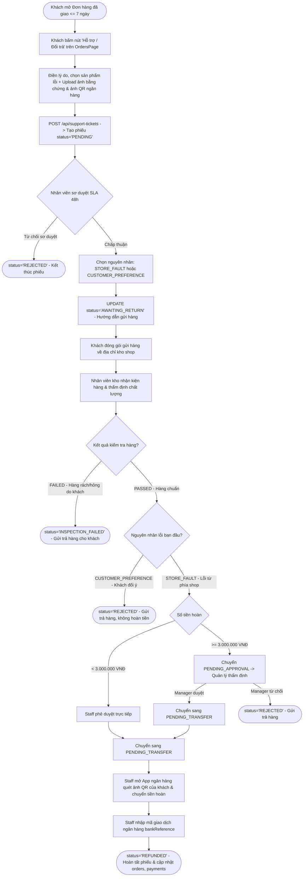
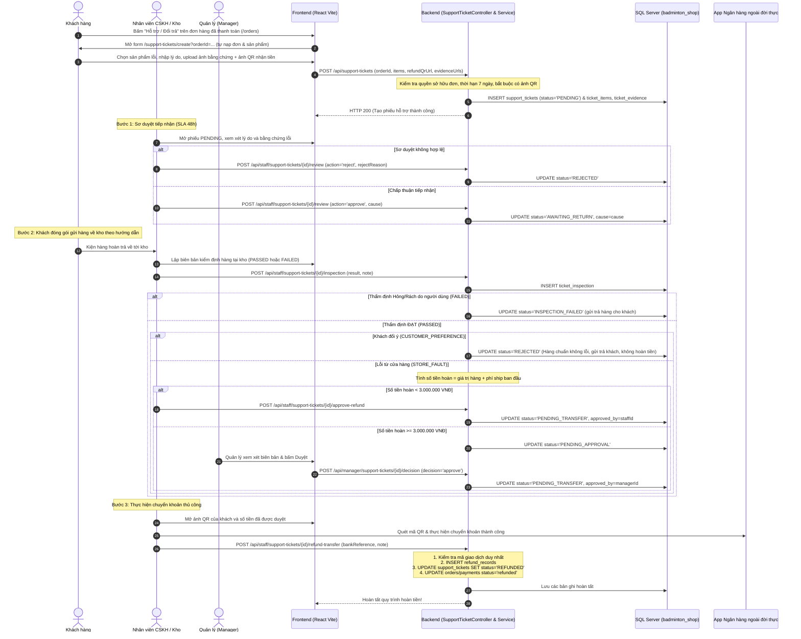

# LUỒNG HOẠT ĐỘNG MODULE HỖ TRỢ ĐỔI TRẢ (SUPPORT TICKET: RETURNS & REFUNDS)
> **Dự án:** Badminton Shop Management System (SBA301_BadmintonShop_SE1986-JV)  
> **Phân hệ:** Support Ticket / Returns & Refunds (Khiếu nại, Trả hàng & Hoàn tiền)  
> **Công nghệ:** Java 21, Spring Boot 3, Spring Data JPA, Spring Security, SQL Server, React (Vite)  
> **Chuẩn kiến trúc:** RESTful Zero `/v1/` (`/api/support-tickets`, `/api/staff/support-tickets`, `/api/manager/support-tickets`)

---

## 1. NGUYÊN TẮC CỐT LÕI & QUY TẮC NGHIỆP VỤ

1. **Phạm vi xử lý (Chỉ Trả hàng & Hoàn tiền - REFUND):**  
   * Hệ thống chỉ tiếp nhận yêu cầu **Trả hàng & Hoàn tiền (`REFUND`)** đối với các đơn hàng đã giao thành công và đã thanh toán (`payment_status = 'paid'`).
   * Thời hạn yêu cầu: Trong vòng **7 ngày** kể từ thời điểm nhận hàng.
   * Khách có nhu cầu đổi sang mẫu hoặc size khác sẽ nhận tiền hoàn và thực hiện đặt đơn hàng mới.
   * Ràng buộc duy nhất: Mỗi đơn hàng chỉ được tạo tối đa 1 phiếu hỗ trợ còn hiệu lực (`UNIQUE order_id`).
2. **Bắt buộc tải ảnh mã QR ngân hàng nhận tiền:**  
   * Khách hàng **bắt buộc tải lên ảnh mã VietQR tài khoản ngân hàng** nhận tiền khi tạo ticket.
   * Không cho nhập số tài khoản / tên ngân hàng dạng text tự do nhằm loại bỏ hoàn toàn rủi ro sai sót thông tin thụ hưởng.
   * Bắt buộc đính kèm tối thiểu 1 hình ảnh hoặc video bằng chứng rõ nét về lỗi sản phẩm.
3. **Chính sách hoàn tiền chỉ áp dụng cho lỗi từ Cửa hàng (`STORE_FAULT`):**  
   * Cửa hàng **chỉ chấp nhận hoàn tiền khi phát sinh lỗi từ phía shop / nhà sản xuất** (`STORE_FAULT`: giao sai mẫu, sai kích thước, bong tróc, nứt gãy, hư hại do vận chuyển...). Cửa hàng **hoàn lại 100% tiền hàng và phí vận chuyển ban đầu**.
   * Trường hợp hàng hoàn về kiểm định đạt chuẩn (hàng nguyên vẹn không lỗi) nhưng nguyên nhân do **khách đổi ý cá nhân (`CUSTOMER_PREFERENCE`)** $\rightarrow$ Hệ thống sẽ **Từ chối phiếu (`REJECTED`)**, gửi trả lại sản phẩm cho khách và **không hoàn tiền**.
   * **Không nhập lại kho (`No Restock`):** Hàng lỗi thu hồi được chuyển bảo hành hãng hoặc tiêu hủy, không tự động cộng lại tồn kho bán đại trà.
4. **Phân quyền duyệt hoàn tiền theo hạn mức 3.000.000 VNĐ:**  
   * Số tiền hoàn **dưới 3.000.000 VNĐ**: Nhân viên CSKH (`STAFF`) có thẩm quyền phê duyệt trực tiếp sang trạng thái chờ chuyển tiền (`PENDING_TRANSFER`).
   * Số tiền hoàn **từ 3.000.000 VNĐ trở lên**: Chuyển sang trạng thái chờ Quản lý phê duyệt (`PENDING_APPROVAL`). Chỉ tài khoản có vai trò `MANAGER` hoặc `ADMIN` mới được phép ra quyết định.
5. **Hoàn tiền thủ công qua quét mã QR (Manual QR Transfer):**  
   * Nhân viên CSKH mở App ngân hàng quét trực tiếp ảnh QR do khách upload, chuyển đúng số tiền đã duyệt, sau đó **nhập Mã giao dịch ngân hàng (`bank_reference`)** vào hệ thống để đối soát và kết thúc phiếu (`REFUNDED`). Không dùng Payout API tự động trừ tiền.
6. **Bảo mật & Cô lập dữ liệu (Data Isolation):**  
   * Khách hàng chỉ xem và thao tác trên các phiếu hỗ trợ do tài khoản mình tạo. Header `X-User-Id` được trích xuất an toàn từ JWT Token của người đăng nhập.

---

## 2. SƠ ĐỒ LUỒNG HOẠT ĐỘNG (FLOWCHART & SEQUENCE DIAGRAM)

### 2.1. Sơ đồ tổng quan quy trình Trả hàng & Hoàn tiền (Flowchart)



---

### 2.2. Sơ đồ tuần tự chi tiết (Sequence Diagram)



---

## 3. MA TRẬN 8 TRẠNG THÁI VÒNG ĐỜI SUPPORT TICKET (STATE TRANSITIONS)

```
[Khách tạo phiếu]
       │
       ▼
    PENDING ──(Khách chủ động hủy)──> CANCELLED
       │
       ├──(Staff từ chối sơ duyệt)──> REJECTED
       │
       └──(Staff chấp thuận sơ duyệt)──> AWAITING_RETURN
                                               │
               ┌───────────────────────────────┴───────────────────────────────┐
               ▼                                                               ▼
        [Kiểm định FAILED]                                              [Kiểm định PASSED]
               │                                                               │
        INSPECTION_FAILED                                     ┌────────────────┴────────────────┐
                                                              ▼                                 ▼
                                                   [Khách đổi ý/không lỗi]             [Lỗi do shop STORE_FAULT]
                                                              │                                 │
                                                           REJECTED                 ┌───────────┴───────────┐
                                                                                    ▼                       ▼
                                                                             [Tiền hoàn < 3M]       [Tiền hoàn >= 3M]
                                                                                    │                       │
                                                                           (Staff duyệt ngay)        PENDING_APPROVAL
                                                                                    │                       │
                                                                                    │               (Manager duyệt)
                                                                                    │                       │
                                                                                    ▼                       ▼
                                                                            PENDING_TRANSFER <──────────────┘
                                                                                    │
                                                                           (Staff quét QR chuyển tiền)
                                                                                    │
                                                                                    ▼
                                                                                 REFUNDED
```

| Trạng thái | Tên tiếng Việt | Quyền thao tác | Ý nghĩa & Điều kiện chuyển tiếp |
| :--- | :--- | :--- | :--- |
| `PENDING` | Chờ tiếp nhận sơ duyệt | Khách hàng, Staff | Phiếu vừa tạo. Khách có thể bấm **Hủy (`CANCELLED`)**. Staff duyệt (`AWAITING_RETURN`) hoặc từ chối (`REJECTED`). |
| `AWAITING_RETURN` | Chờ khách gửi lại hàng | Khách hàng, Staff | Khách đóng gói gửi hàng về kho shop. Nhân viên kho nhận hàng và lập biên bản kiểm định. |
| `INSPECTION_FAILED`| Kiểm tra hàng không đạt | - | Trạng thái kết thúc. Hàng rách/hỏng do lỗi người dùng. Gửi trả lại khách, chặn hoàn tiền. |
| `PENDING_APPROVAL` | Chờ Quản lý duyệt | Quản lý (`MANAGER`) | Hàng đạt chuẩn do lỗi shop nhưng số tiền hoàn $\ge 3.000.000$ VNĐ. Quản lý duyệt hoặc từ chối. |
| `PENDING_TRANSFER` | Chờ chuyển tiền | Nhân viên (`STAFF`) | Khoản hoàn đã được duyệt (Staff duyệt nếu $< 3$M, Quản lý duyệt nếu $\ge 3$M). Chờ Staff quét QR chuyển tiền. |
| `REFUNDED` | Đã hoàn tiền | - | Trạng thái kết thúc. Staff nhập mã giao dịch ngân hàng thành công. Ghi nhận bảng `refund_records`. |
| `REJECTED` | Bị từ chối | - | Trạng thái kết thúc. Bị từ chối ở bước sơ duyệt, hoặc do khách đổi ý (`CUSTOMER_PREFERENCE`), hoặc do Quản lý từ chối. |
| `CANCELLED` | Khách đã hủy | - | Trạng thái kết thúc. Khách chủ động hủy khi phiếu còn ở trạng thái `PENDING`. |

---

## 4. DANH MỤC API SPECIFICATIONS MODULE SUPPORT TICKET (ZERO `/v1/`)

### 4.1. Dành cho Khách hàng (`/api/support-tickets`)

| Method | Endpoint | Quyền truy cập | Mục đích nghiệp vụ |
| :--- | :--- | :--- | :--- |
| `POST` | `/api/support-tickets` | Authenticated | Khách hàng tạo phiếu yêu cầu Trả hàng & Hoàn tiền kèm ảnh QR và bằng chứng |
| `GET` | `/api/support-tickets` | Authenticated | Khách hàng xem danh sách phiếu hỗ trợ của tài khoản mình |
| `GET` | `/api/support-tickets/{id}` | Authenticated (Chính chủ) | Khách hàng xem chi tiết tiến trình xử lý phiếu hỗ trợ |
| `POST` | `/api/support-tickets/{id}/cancel` | Authenticated (Chính chủ) | Khách hàng hủy yêu cầu hỗ trợ (chỉ khi phiếu đang ở trạng thái `PENDING`) |

### 4.2. Dành cho Nhân viên CSKH & Kho (`/api/staff/support-tickets`)

| Method | Endpoint | Quyền truy cập | Mục đích nghiệp vụ |
| :--- | :--- | :--- | :--- |
| `GET` | `/api/staff/support-tickets` | `STAFF`, `MANAGER`, `ADMIN` | Xem hàng đợi danh sách ticket cần xử lý (lọc theo `status`, `type`) |
| `GET` | `/api/staff/support-tickets/{id}` | `STAFF`, `MANAGER`, `ADMIN` | Xem chi tiết thông tin và biên bản kiểm định của 1 phiếu |
| `POST` | `/api/staff/support-tickets/{id}/review` | `STAFF`, `MANAGER`, `ADMIN` | Sơ duyệt tiếp nhận (SLA 48h): duyệt chọn `cause` hoặc từ chối |
| `POST` | `/api/staff/support-tickets/{id}/inspection` | `STAFF`, `MANAGER`, `ADMIN` | Ghi nhận biên bản thẩm định hàng tại kho (`PASSED` / `FAILED`) |
| `POST` | `/api/staff/support-tickets/{id}/approve-refund` | `STAFF`, `MANAGER`, `ADMIN` | Nhân viên phê duyệt hoàn tiền (áp dụng cho khoản hoàn dưới 3.000.000 VNĐ) |
| `POST` | `/api/staff/support-tickets/{id}/refund-transfer` | `STAFF`, `MANAGER`, `ADMIN` | Nhân viên quét ảnh QR chuyển tiền và lưu mã giao dịch `bankReference` |

### 4.3. Dành cho Quản lý (`/api/manager/support-tickets`)

| Method | Endpoint | Quyền truy cập | Mục đích nghiệp vụ |
| :--- | :--- | :--- | :--- |
| `POST` | `/api/manager/support-tickets/{id}/decision` | `MANAGER`, `ADMIN` | Quản lý phê duyệt (`approve`) hoặc từ chối (`reject`) khoản hoàn $\ge 3.000.000$ VNĐ |
| `GET` | `/api/manager/support-tickets/settings/threshold` | `MANAGER`, `ADMIN` | Xem ngưỡng phê duyệt hoàn tiền hiện tại của hệ thống (mặc định 3.000.000 VNĐ) |
| `PUT` | `/api/manager/support-tickets/settings/threshold` | `MANAGER`, `ADMIN` | Cập nhật ngưỡng phê duyệt hoàn tiền mới |
